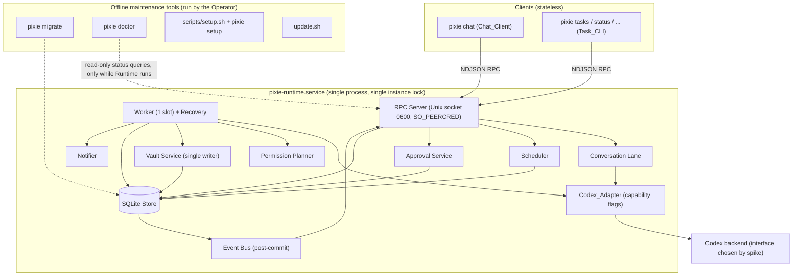
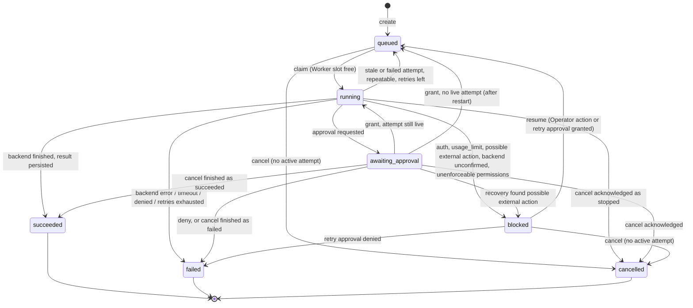
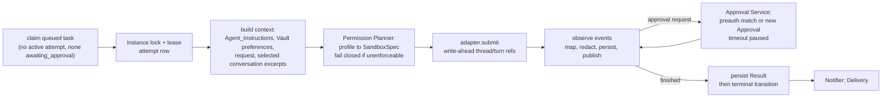

# Design Document

## Overview

Pixie Phase 0 is a single-user, always-on assistant built inside this fork. It is a Python 3.14.4 (`>=3.14.4,<3.15`) asyncio daemon (the Runtime, `pixie-runtime.service`) that owns a SQLite Store, a Scheduler, a one-slot Worker, a conversation lane, an approval mechanism, a vault service, and result delivery. Codex is the only execution backend, reached through a narrow application-owned Codex_Adapter. Two thin clients, `pixie chat` and the Task_CLI, talk to the Runtime over a Unix domain socket and never touch the Store, the Scheduler, or the Vault.

The design is organised around five ideas.

1. **The Runtime is the only stateful process** (Requirements 10.3, 20.3). Clients are stateless views. Closing a client changes nothing (10.4).
2. **The Codex integration is unknown until the spike runs** (Requirement 1, decisions D2, D3, D5). Everything above the adapter depends on a capability record, not on a specific interface. The spike is the first task. Section "Open decisions map" lists what depends on what and how the design degrades.
3. **The Store is the source of truth and every state change is a transaction** (4.4, 5.1). A confirmation shown to the Operator is always generated by the Runtime after a commit (12.2), never taken from model text.
4. **Permissions are enforced by the backend sandbox, not by prompts** (8.12). The Runtime computes a sandbox specification from the Permission_Profile and fails closed if the adapter cannot honour it (8.13).
5. **Recovery never replays possible external actions** (7.4 to 7.12). Write-ahead `external_action_begin` events and a per-instance identifier make restart reconciliation deterministic and idempotent.

### Scope and non-goals

In scope: everything in `requirements.md` for Phase 0. Out of scope: voice, visuals, gestures, remote access, concurrent execution, macOS and Windows (D8), the personalization interview (D19). The only Phase 1 accommodation is the single client interface (Requirement 20).

### Research summary

Findings gathered while designing. Items marked **unverified** are not confirmed from primary documentation and are routed to the spike or to a verification task.

- Codex documents an OS-enforced sandbox plus a separate approval policy, and a notion of permission profiles that can limit edits to selected roots ([Codex permissions](https://developers.openai.com/codex/permissions), [Codex sandbox and approvals](https://developers.openai.com/codex/sandbox)). Whether **reads** can be confined to a directory is **unverified**; in the sandbox modes described by those pages, read-only is described as inspecting a project, not as confining reads to it.
- Codex builds its instruction chain from a global file in `CODEX_HOME`, then `AGENTS.md` files from the project root (normally the Git root) down to the working directory, capped at 32 KiB by default ([AGENTS.md guide](https://developers.openai.com/codex/guides/agents-md)). If no project root is found, only the working directory is checked. Spike P0-01 (report section 11, 17b-1) showed that a working directory outside a repository does not avoid an inherited ancestor `AGENTS.md`; isolation therefore relies on `project_doc_max_bytes = 0` plus `explicit` injection (Section "Instruction isolation").
- A community report states that in some hardened environments the sandbox can fail quietly and a non-interactive run can exit 0 having run nothing ([sandbox note](https://yeet.cx/topical-takes/sandbox-codex-linux)). This is **unverified** but cheap to guard against: the Doctor_Script and a smoke test include a canary write that must be blocked (8.14).
- Cron evaluation: `cronsim` is a cron expression parser and evaluator documented as working on Python 3.10+ ([PyPI](https://pypi.org/project/cronsim/)). Python 3.14 install, timezone-aware evaluation, and DST gap and overlap behaviour are **unverified**. The design isolates the library behind `cron.py` and adds a verification task (decision D14 leaves the library as a design choice). `croniter` was not evaluated.
- systemd restart backoff (`RestartSteps`, `RestartMaxDelaySec`) exists only in newer systemd versions; the version on the Operator's Ubuntu 26.04 machine is **unverified** and the Doctor_Script checks `systemctl --version`. Requirement 9.4 accepts approximate growth from about 2 s up to 60 s, and accepts a fixed `RestartSec` on older systemd provided the fallback is documented (decision D32). Requirement 9.14 requires `docs/operations.md` to state which mechanism is in use, the delay values in effect and the systemd version observed.
- App-server dynamic tools (one possible way to offer Runtime host tools to the model) are reported to be experimental. This is **unverified** here; the spike must verify them against the exact pinned version before the design relies on them (MCP configuration is the alternative route).
- Python environment tooling is `uv` (decision D31, Requirements 1.2, 9.1, 16.3, 16.13, 17.3). The dependency pin is `uv.lock`; environments are created with `uv sync`; the stdlib `venv` module and bare `pip` are not used. Python 3.14.4 availability through uv is **unverified** and covered by the Setup prerequisite check and V-1/V-2.

## Architecture

### Process and trust model



Clients speak only to the socket. The Offline tools are Operator maintenance commands that open files directly while the Runtime is stopped (`migrate`, `update`) or stop and restart the service themselves (`setup`, Requirement 16.14); they are not clients in the sense of Requirements 10.3 and 20.3 (Requirement 13.9). The one exception is the Doctor_Script: while the Runtime runs it is a read-only socket client limited to status and health queries and never opens the Store; while the Runtime is stopped it skips the Runtime-dependent checks and reports them as "Runtime not running" (13.9, 16.6).

### Concurrency model

One asyncio event loop runs the server, scheduler tick, worker loop, heartbeat, watchdog, conversation lane, and notifier. All SQLite access goes through one dedicated database thread (a single-thread executor) so that transactions are serialised and the event loop never blocks. Database calls are short; the heartbeat is a DB write and therefore queues behind at most a few small statements.

Two lanes call the adapter:

- **Worker lane**: at most one Attempt at a time (7.1).
- **Conversation lane**: chat turns, serialised per Conversation (11.8) and limited globally by `chat.max_concurrent_turns` (default 1, judgment call J-6). A queued turn reports its position (11.10).

The lanes are independent, so chat stays responsive while a Task runs (11.9). The Worker slot is not consumed by chat turns.

### Task lifecycle

Requirements define the seven States (5.1) and the permitted transitions (5.13). The diagram below is the design's rendering of the 5.13 table. The table in `lifecycle.py` is the only authority; the Store also enforces it with a trigger that forbids leaving a terminal State.



Notes:

- A cancellation request is **not** a State. It is a separate `cancellation_requests` row (5.3). While it is pending the Task keeps its State and status output shows `cancellation: pending` (5.11).
- `running --> queued` is used for stale re-queue (7.5) and bounded network retry (5.9).
- `blocked --> queued` requires an explicit Operator action: `pixie tasks resume <id>` or granting a `retry_review` Approval (5.14, 5.15, 7.6).

### Task execution path



### Chat-to-task registration

Registration uses a structured channel, never reply text (12.1). The preferred channel is a host tool bridge (capability `host_tools`); the guaranteed channel is explicit slash commands in the Chat_Client.

```mermaid
sequenceDiagram
    autonumber
    participant Op as Operator
    participant CC as Chat_Client
    participant RT as Runtime (server + conversation lane)
    participant CX as Codex (chat thread)
    participant ST as Store
    Op->>CC: "Every weekday 9:00 summarise project X"
    CC->>RT: conversations.send_turn(text)
    RT->>CX: turn (tools: propose_schedule, create_task, list_tasks, get_result)
    CX-->>RT: tool call propose_schedule(cron, tz, request, project)
    RT->>RT: validate (cron, IANA tz, allowed project root)
    alt ambiguous or invalid
        RT-->>CX: tool result needs_clarification(field)
        CX-->>CC: one clarifying question (streamed)
    else valid
        RT->>ST: tx: count pending non-expired proposals
        alt 3 already pending
            RT-->>CC: PROPOSAL_LIMIT "3 proposals pending: /confirm or /discard one first" (nothing evicted)
        else room available
            RT->>ST: insert schedule_proposals P-7 (pending, expires_at = now + ttl), preview_hash
            RT-->>CC: system entry: cron, tz, next 3 run times, expiry time, "/confirm P-7"
            CX-->>CC: streamed prose (told not to claim registration)
            Op->>CC: /confirm P-7 (client sends the preview_hash it displayed)
            CC->>RT: schedules.confirm_proposal(P-7, preview_hash)
            RT->>ST: load P-7; reject if unknown, discarded, consumed or now >= expires_at
            RT->>RT: recompute next 3 run times in the proposal's zone
            alt recomputed times differ from the displayed preview
                RT->>ST: store new preview, P-7 stays pending (expiry unchanged)
                RT-->>CC: PREVIEW_CHANGED + new preview, no Schedule created, Operator must /confirm again
            else same preview
                RT->>ST: BEGIN; UPDATE proposal pending to consumed (single use); insert schedule + event; COMMIT before deadline (10 s)
                alt commit ok
                    ST-->>RT: schedule id S-3
                    RT-->>CC: system entry "Accepted S-3" + interpretation (<=2 s)
                else commit failed or deadline passed (ROLLBACK)
                    RT-->>CC: error "not registered", proposal still pending, no Schedule exists
                end
            end
        end
    end
```

**Proposal rules (Requirements 6.11 to 6.16 and 12.5, decision D28).**

- Proposals are rows in `schedule_proposals`, not memory, so they survive a Runtime restart. Their expiry is an absolute timestamp, so restart does not extend or shorten it.
- TTL is `schedules.proposal_ttl_minutes` (default 30, range 1 to 1440). A config change applies to new proposals only.
- At most 3 proposals may be `pending` and unexpired at a time. The count and the insert happen in one transaction. A 4th request is rejected with `PROPOSAL_LIMIT` and a message telling the Operator to `/confirm` or `/discard` one. No existing proposal is evicted or changed. Expired proposals do not count.
- `/confirm [P-n]`: with an id, it targets that proposal. Without an id it defaults to the only pending proposal; if several are pending it is rejected with `AMBIGUOUS_PROPOSAL` and lists them. Unknown, discarded, expired and already consumed ids are rejected (`NOT_FOUND`, `PROPOSAL_DISCARDED`, `PROPOSAL_EXPIRED`, `PROPOSAL_CONSUMED`). A proposal whose `now >= expires_at` is never confirmable, even if the sweep has not yet marked it `expired`.
- Single use: confirmation is a conditional update (`status='pending' AND expires_at > now`) in the same transaction as the Schedule insert. A repeated `/confirm` is rejected with `PROPOSAL_CONSUMED` naming the Schedule it created, and creates nothing.
- Preview at confirm time: `confirm_proposal` carries the `preview_hash` of the run times the client displayed. The Runtime recomputes the next three run times (one for one-off) and compares. A difference (timezone database or library change, a one-off time that has since passed, clock effects) returns `PREVIEW_CHANGED` with the new preview, updates the stored preview, leaves the proposal pending with its original expiry, and creates nothing. The Operator must see the new preview and confirm again. A one-off whose run time is already in the past at confirm time is rejected as `INVALID_ARGUMENT` (run time passed).
- `/proposals` lists pending proposals with expiry; `/discard P-n` marks one `discarded` (a discarded proposal frees its slot). Both go through `schedules.proposals` and `schedules.discard_proposal`.

`create_task` follows the same path without the preview: the tool call commits the Task and returns its identifier; the Runtime then emits a system entry "Accepted T-42" (12.2, 12.4). The originating `conversation_id` is stored on the Task (12.7).

### Restart recovery

```mermaid
sequenceDiagram
    autonumber
    participant SD as systemd
    participant RT as Runtime (new instance)
    participant LK as run/runtime.lock
    participant ST as Store
    participant AD as Codex_Adapter
    SD->>RT: start
    RT->>LK: flock(LOCK_EX|LOCK_NB)
    alt lock held
        RT-->>SD: exit 75 (second instance refused)
    end
    RT->>RT: load and validate config (exit 78 on error)
    RT->>ST: open, check schema version
    alt newer than supported
        RT-->>SD: exit 78, Store untouched (4.8)
    else migration pending
        RT-->>SD: exit 78, "run: pixie migrate" (4.2, 9.5)
    else missing
        RT->>ST: initialize at current version
    end
    RT->>RT: instance_id = new uuid4
    RT->>ST: SELECT unreconciled attempts: reconciled_at IS NULL, instance_id != mine, state in claimed, running, awaiting_approval, interrupted (including shutdown-interrupted), stale
    loop each unreconciled attempt (before any claim)
        RT->>ST: mark attempt stale (or keep interrupted), event
        RT->>AD: confirm_inactive(backend pid + start time), force_stop if alive
        alt not confirmed inactive
            RT->>ST: pending cancellation: keep State and request, retry confirmation (5.12); otherwise blocked + retry_review Approval (7.11)
        else pending cancellation request (inactivity confirmed)
            RT->>ST: cancelled (or succeeded/failed if finished), note possible external action
        else task was awaiting_approval and no external action
            RT->>ST: attempt interrupted and reconciled; Task and Approval unchanged (7.12)
        else retry_safety = review_required (external action recorded or not repeatable)
            RT->>ST: blocked + retry_review Approval (7.6)
        else retries < max
            RT->>ST: queued, retries+1 (7.5)
        else
            RT->>ST: failed, category of last failed attempt (7.7)
        end
    end
    RT->>ST: Scheduler catch-up per missed-run policy (6.6)
    RT->>RT: bind socket, start Worker, Scheduler, lane
    RT-->>SD: sd_notify READY=1 (within 30 s, 9.2)
```

### Cancellation

```mermaid
sequenceDiagram
    autonumber
    participant Cl as Client
    participant RT as Runtime
    participant ST as Store
    participant AD as Adapter
    Cl->>RT: tasks.cancel(T-42)
    RT->>ST: tx: terminal? error TERMINAL (5.4)
    alt no active attempt (queued, blocked)
        RT->>ST: tx: state cancelled + note possible external action (5.10)
        RT-->>Cl: cancelled
    else active attempt (running, awaiting_approval)
        RT->>ST: tx: insert cancellation_request pending, withdraw pending Approvals, event (<=1 s, 5.3, 5.11)
        RT-->>Cl: "cancellation pending"
        RT->>AD: request_cancel(handle)
        alt ack outcome within 30 s
            AD-->>RT: stopped | finished_succeeded | finished_failed
            RT->>ST: tx: record work performed, then state cancelled | succeeded | failed (5.5)
        else no ack within 30 s
            RT->>ST: event cancel_unacknowledged; State and request retained (5.6)
            Note over RT: keeps waiting; restart reconciliation resolves it (5.12)
        end
    end
```

### Repository layout (reconciled with the existing fork)

Existing files: `CLAUDE.md`, `fullstack-agent.md`, `start.sh`, `start.bat`, `update.sh`, `update.bat`, `README.md`, `TROUBLESHOOTING.md`, `CONTRIBUTING.md`, `LICENSE`, `.gitignore`, `.gitattributes`, `docs/always-on-agent-prototype-plan.md`. The plan's illustrative layout is adopted with these reconciliations.

```text
pixie-fullstack/
  AGENTS.md                      NEW. Repository development rules only (18.1). Never installed.
  LICENSE                        UNCHANGED, byte-for-byte (18.6).
  README.md TROUBLESHOOTING.md CONTRIBUTING.md   REWRITTEN for Phase 0 (18.2), attribution kept.
  components.toml                NEW. Version manifest: remote, Reviewed_Revision, pinned revision, license file hash.
  pyproject.toml                 NEW. requires-python >=3.14.4,<3.15; script entry `pixie`; dependencies managed with uv.
  uv.lock                        NEW. Exact resolved versions and hashes (uv). The dependency pinning method of Requirement 1.2.
  start.sh                       ADAPTED (18.3). Prints service status and how to run `pixie chat`. Never starts or stops the Runtime.
  update.sh                      ADAPTED. Thin shim to `pixie update` (17). No blind pull (18.5).
  start.bat update.bat           MOVED to legacy/ (D8). Not part of Phase 0.
  legacy/
    README.md                    States files are retained pending the Operator's removal decision (18.10).
    CLAUDE.md fullstack-agent.md start.sh update.sh start.bat update.bat   Unmodified originals.
  src/pixie_runtime/             NEW. See Components.
  config/pixie.example.toml      NEW. Placeholders only; model and reasoning effort commented (2.11, 15.3).
  templates/agent/AGENTS.md      NEW. Original Pixie identity text (D18). Installed by setup.
  systemd/pixie-runtime.service.in   NEW. Rendered by setup into ~/.config/systemd/user/.
  scripts/setup.sh doctor.sh     NEW. Thin bootstraps; logic in Python for testability.
  scripts/prereqs.py             NEW. Standard-library-only prerequisite check, run with `uv run --no-project` (creates no environment).
  spikes/p0-01/                  NEW. Spike scripts and raw outputs.
  tests/{unit,property,integration,smoke}/
  docs/
    always-on-agent-prototype-plan.md   MOVED (18.11), kept in place.
    operations.md                NEW. Runbook, update and recovery procedure (17.3, 17.6, 19.4).
    spike-p0-01-report.md        NEW. Spike report (Requirement 1).
    verification.md              NEW. Recorded verification results (19.3 to 19.9).
    licensing.md                 NEW. Mixed licensing statement and not-legal-advice note (18.14).
    reviewed-revisions.md        NEW. Reviewed_Revisions 5bb159f and 659bba9 (18.9, 18.17).
```

Decisions behind the layout:

- The conversational installer wizard is not carried into Phase 0. Requirement 18.1 removes the Claude-oriented boot path and D19 defers the interview, so nothing remains to host a wizard. `scripts/setup.sh` is the single entry point (16.1). Original wizard files are preserved in `legacy/` and in git history.
- Moves use `git mv` into `legacy/` for files no longer used and `cp` for `start.sh` and `update.sh` (so root paths keep working in adapted form). No history rewrite (18.8).
- A `upstream` remote pointing to `jaredrhod/fullstack-agent` is added and documented as a setup step for the maintainer; it is never fetched automatically (17.1).
- Every new source file carries `SPDX-License-Identifier: AGPL-3.0-or-later` and the project owner's copyright line. Adapted files keep the original copyright (Jared Rhodenizer) (18.6).
- The Vault_Template_Repo is a sibling checkout (`../pixie-ai-memory-vault`). It supplies Vault templates only; no template text is copied into this repository (D18, 3.1).

### Runtime_Home layout

Default `~/.pixie` (override with `PIXIE_HOME`; judgment call J-1). Directory mode 0700.

```text
~/.pixie/
  config/pixie.toml          Operator-owned. Created if missing, never overwritten.
  config/secrets.toml        0600. Credential values used for redaction (15.1).
  state/pixie.db (+ -wal -shm)
  run/runtime.sock           0600
  run/runtime.lock
  results/<task_id>/         Results_Location, also the Codex working directory for that Task
  agent/AGENTS.md            Agent_Instructions (default location)
  codex/                     Dedicated CODEX_HOME, mode 0700, credential file 0600 (enforced by setup, checked by doctor)
  backups/<timestamp>/       Store and config backups (4.2, 16.5, 17.3)
  install-manifest.json      Setup_Managed_File: installed components, revisions, dependency versions (16.3)
  venv/                      uv-managed environment, created by `uv sync --locked` from uv.lock (UV_PROJECT_ENVIRONMENT points here)
```

During development `PIXIE_HOME` may point inside the checkout (`.pixie-dev/`), which `.gitignore` excludes entirely (15.4).

## Components and Interfaces

### Module map (`src/pixie_runtime/`)

| Module | Responsibility | Requirements |
| --- | --- | --- |
| `config.py`, `paths.py` | Load, validate, and migrate TOML; resolve Runtime_Home; single Vault path entry | 2.11, 3.15, 16.5 |
| `store/` (`db.py`, `repo.py`, `migrations/NNNN_*.sql`, `migrate.py`) | SQLite access, transactions, migrations, backup | 4 |
| `lifecycle.py` | Pure transition table and guards | 4.6, 5 |
| `tasks.py` | Task creation, validation, cancellation, resume | 5, 8.1, 12 |
| `scheduler.py`, `cron.py` | Schedule evaluation, occurrence enqueue, missed-run policy | 6 |
| `worker.py`, `recovery.py`, `leases.py` | Claim, execute, heartbeat, timeout, reconcile | 7 |
| `adapter/base.py` | Adapter protocol, capability record, Application_Event types | 2 |
| `adapter/fake.py` | Scripted adapter for automated tests | 19.8 |
| `adapter/sdk.py`, `adapter/appserver.py`, `adapter/execcli.py` | Candidate backends. The spike selects one; Phase 0 implements only that one (plus the fake adapter), not all three | D2 |
| `adapter/mapper.py` | Table-driven raw event to Application_Event mapping | 2.2 to 2.4 |
| `permissions.py` | Profiles to SandboxSpec, path canonicalisation, quotas, preauthorisations | 8 |
| `approvals.py` | Approval creation, matching, answering | 8.3 to 8.9, 8.15 |
| `vault.py` | Read preferences, serialised writer, protected sections | 3 |
| `prompts.py` | Assemble instructions and first prompt | 3.2 to 3.16 |
| `conversations.py` | Conversations, turns, lane, thread mapping, host tools for chat | 10.6, 11, 12 |
| `hosttools.py`, `toolbridge.py` | Runtime-side tool handlers and the stdio bridge process Codex launches | 12.1, 3.7 |
| `server.py`, `protocol.py` | NDJSON RPC over Unix socket, peer credential check, method dispatch | 10, 20 |
| `client.py` | Single client interface used by chat and CLI | 20.1 |
| `cli.py`, `chat.py` | Task_CLI and Chat_Client | 11, 13 |
| `notifications.py` | `notify-send` delivery | 14 |
| `redaction.py` | Redactor and leak detector, used by every sink | 15 |
| `sdnotify.py`, `runtime.py` | systemd notify, startup sequence, shutdown | 7.8, 7.10, 9 |
| `setup.py`, `doctor.py`, `update.py` | Setup, Doctor_Script logic, update procedure | 16, 17 |

### Codex_Adapter

The adapter is the only module that knows a Codex type. Callers see application types only (2.1).

```python
class CodexAdapter(Protocol):
    capabilities: AdapterCapabilities          # fixed after start(); filled from the spike report
    async def start(self) -> None: ...
    async def close(self) -> None: ...
    async def check_auth(self) -> AuthStatus: ...                      # ok | missing | expired | unknown, <= 30 s (2.9)
    async def list_models(self) -> ModelCatalog | None: ...            # None if capability absent
    async def submit(self, req: ExecutionRequest,
                     on_refs: Callable[[BackendRefs], Awaitable[None]]) -> ExecutionHandle: ...
    def observe(self, h: ExecutionHandle) -> AsyncIterator[ApplicationEvent]: ...
    async def answer_approval(self, h, approval_ref: str, decision: Decision) -> None: ...
    async def request_cancel(self, h) -> None: ...                     # ack arrives as an ApplicationEvent
    async def get_result(self, h) -> ExecutionResult: ...
    async def is_alive(self, h) -> bool: ...                           # heartbeat gate (7.2)
    async def confirm_inactive(self, ref: BackendRef) -> Liveness: ... # inactive | active | unknown
    async def force_stop(self, ref: BackendRef) -> None: ...
```

**Approval answering and the read loop (spike task 3.1).** `answer_approval` is asynchronous and may be called long after the backend asked. The unmodified Python SDK cannot support this: its handler's return value is the reply and it runs on the SDK reader thread, so a waiting handler stalls `interrupt`. The adapter therefore owns the read loop (a direct app-server JSON-RPC client), queues server requests, and answers them later; the spike measured interrupt at 0.009 s with an approval pending. An interrupt cancels the pending approval (`serverRequest/resolved`). `accept` lifts the sandbox for the shown command, so the Runtime always shows the exact command, never defaults to `accept`, and has no auto-accept path.

`submit` awaits `on_refs` after the thread reference and again after each turn reference. If `on_refs` raises (persistence failure), the adapter stops and makes no further submissions for that Attempt (2.5, 2.6).

`ExecutionRequest` carries: instructions text, prompt, working directory, `SandboxSpec` (mode, writable roots, read roots, network flag, approval policy; confinement is expressed as a named permission profile), model and reasoning effort (both optional), `resume_thread_ref` (optional), host tool set (optional), and an output schema (optional). Callers never pass Codex types.

**Capability record** (`AdapterCapabilities`), each flag set from the spike report and re-verified by `pixie doctor --probe`:

| Flag | Meaning | Consumed by |
| --- | --- | --- |
| `streaming_events` | Incremental events | 2.2, 11.3 |
| `thread_resume` | Restore a thread by reference | 2.5, 7.12, 11.5 |
| `interrupt` | Stop an active run within 10 s | 5.5, 10.6 |
| `approval_requests` | Backend approval requests reach the Runtime | 8.3, 8.4 |
| `sandbox_read_only` | Backend can enforce no writes | 8.10, 8.13 |
| `sandbox_writable_roots` | Backend can limit writes to listed roots | 8.11, 8.13 |
| `read_confinement` | Backend can limit reads to listed roots | 8.2, 8.16 |
| `host_tools` | Runtime tools can be offered to the model | 12.1, 3.7 |
| `output_schema` | Schema-constrained final output | fallback for 12.1 |
| `instruction_injection` | `explicit` \| `codex_home` \| `inline` | 3.2, 3.16 |
| `model_selection`, `effort_selection`, `list_models` | Configurable model | 2.11 |
| `auth_probe` | Detect expired login without running a task | 2.9, 16.6 |
| `unattended_login` | ChatGPT-subscription login works from a user service | D3, 1.9 |
| `backend_pid_report` | Child process id and start time are reportable | 7.4, 7.11 |

**Event mapping** (`mapper.py`). Each backend ships a table `raw_type -> function(raw) -> ApplicationEvent`. Mapping is total: a supported type yields exactly one Application_Event in emission order; an unsupported type yields `unmapped{raw_type}`; an unparsable payload yields `parse_failure{raw_truncated<=10000 chars}`. None of these change Task State (2.3, 2.4). Application_Event kinds: `thread_started`, `turn_started`, `message_delta`, `message`, `command`, `file_change`, `tool_call`, `progress`, `approval_requested`, `cancel_acknowledged`, `usage`, `result`, `error`, `unmapped`, `parse_failure`. Delivery to subscribers is within 1 s of receipt through a per-attempt ordered queue (2.2).

**Degradation by backend.** The Runtime is written against capabilities. Expected behaviour (all **unverified** until the spike):

| Capability | A. Python SDK | B. App-server JSON-RPC | C. `codex exec` (non-interactive) |
| --- | --- | --- | --- |
| Streaming | expected | expected | JSONL events expected |
| Thread resume | expected | expected | via resume subcommand, expected |
| Interrupt | expected | expected | signal to child; ack = exit |
| Approval requests | expected | expected | not expected: no interactive approvals |
| Host tools | via MCP config or dynamic tools | same | via MCP config only |
| Python 3.14.4 support | unverified, may force B | n/a (we write the client) | n/a |

Degradation rules. The A, B, C fallback order is a **spike-time selection order**, not runtime fallback: after the spike, Phase 0 builds and ships only the one selected backend adapter. The rules below describe what the rest of the design loses if a lower candidate is the one selected.

- **A fails (for example no Python 3.14.4 support or no unattended login):** fall to B. We implement a small JSON-RPC stdio client for the subset used (initialise, thread start and resume, turn start and interrupt, approval server requests, notifications). Nothing above the adapter changes.
- **B fails:** fall to C. Without `approval_requests`, backend approvals cannot exist. The sandbox denies out-of-bounds operations outright; the Runtime records a `sandbox_denied` event and the Task continues or fails on its own merits. Requirements 8.3 and 8.4 are then met only for Runtime-mediated operations (Vault edits, retry review). Tasks needing external changes are not supported and this limitation is recorded in `docs/verification.md` (19.6). Interrupt is a signal; cancellation acknowledgement is process exit.
- **`host_tools` absent:** chat delegation falls back to schema-constrained structured output if `output_schema` exists (the Runtime validates the JSON, and its own code, not the model, announces registration); otherwise only explicit slash commands and the Task_CLI create work. Tasks cannot write the Vault (3.7, 3.8, 3.14 apply only to Operator-initiated writes).
- **Natural-language delegation is a required spike outcome.** The spike must prove, with the selected backend, that a natural-language chat request causes the model to invoke a structured Runtime operation (`create_task` or `propose_schedule`) and that the Runtime returns a persisted task identifier (or proposal identifier). The result is recorded in the spike report next to Requirement 1.3's items. If only slash commands are available, that is recorded as **reduced conversational functionality**, not as a pass. Requirement criteria affected by a slash-only outcome: 12.1 still holds (slash commands are structured operations), but the conversational intent of 12.5 (the Runtime interpreting a Schedule from a chat message) and 12.6 (a clarifying question for an ambiguous message) can only be met as argument validation errors from the slash command, and the Introduction's "converse, persist delegated work" loop and 19.5's "scheduled through `pixie chat`" are met only through `/schedule`. Whether the requirements need to be reworded for that case is reported to the Operator and is not decided in this design.
- **`sandbox_read_only` or `sandbox_writable_roots` absent:** the corresponding profile fails closed (8.13).
- **`unattended_login` false:** scope review with the Operator before dependent work continues (Introduction of the requirements).

### Permission Planner (`permissions.py`)

Input: Task (profile, Project_Directory, Results_Location), adapter capabilities, config. Output: `SandboxSpec` or a refusal.

| Profile | Sandbox mode | Writable roots | Approval policy | Network | Working directory |
| --- | --- | --- | --- | --- | --- |
| `read-only` (8.10) | read-only | none | `on-request` when `approval_requests`, else `never` | off | Results_Location |
| `workspace-write` (8.11) | workspace-write | `[Results_Location]` only; `/tmp` and `$TMPDIR` writes excluded where the backend supports it | same | off | Results_Location |
| conversation turn (chat) | read-only | none | `never`; any request is auto-declined and logged | off | per-conversation scratch dir |

Rules:

1. **Reads.** The prompt names the Project_Directory and the Vault path. If `read_confinement` is true, only those roots plus the working directory are readable. If false, the Task still runs (the requirements make 8.13 fail-closed for writes only) but the Runtime records a `read_confinement_unavailable` warning event on every Attempt and the Doctor_Script reports it (8.16, decision D30).
2. **Writes.** `read-only` requires `sandbox_read_only`. `workspace-write` requires `sandbox_writable_roots`. Missing capability: the Task is set to `blocked` with category `permission_unenforceable`, no Attempt starts, the reason is reported (8.13).
3. **Canonicalisation.** Project_Directory, Results_Location and Vault are resolved with `realpath` at Task creation and again at claim. A Project_Directory that is a symlink escaping an allowed root is rejected. Path checks used by the Runtime itself (quota audits, Vault writes) use `os.path.realpath` plus a containment check on resolved parents, never string prefixes (8.2).
4. **Allowed roots.** Chat-created Tasks may name only a Project_Directory inside `projects.allowed_roots` (config). The model is not trusted to choose arbitrary paths. CLI-submitted Tasks must pass `--project` or rely on `projects.default`; otherwise creation is rejected naming the missing value and nothing is persisted (8.1).
5. **Quotas.** After each Attempt and on each `file_change` event, the Runtime audits Results_Location: at most 100 files and 10 MB per file. A violation ends the Attempt with category `limit_exceeded`; files are kept for review, not deleted. The backend sandbox cannot enforce these quotas, so enforcement is after-the-fact (8.2, 8.17).
6. **Tripwire (defence in depth, judgment call J-9).** For `read-only` Attempts on a Git working tree, the Runtime records `git status --porcelain` and HEAD before and after. A change ends the Attempt with `policy_violation`. This does not replace the sandbox.
7. **Out-of-bounds operations (8.3, 8.4).** When the backend surfaces an approval request, the Approval Service canonicalises the operation, looks for a matching preauthorisation, otherwise creates exactly one Approval within 2 s and sets `awaiting_approval`.
8. **Sandbox canary (8.14, 13.9, decision D33).** The canary is a smoke test. `pixie doctor --probe` runs the same bounded Task only while the Runtime is stopped; a running Doctor_Script stays status-only and never runs it. It tries to write outside its roots under a prompt that demands it; the write must be blocked. An automated test with the fake adapter asserts the Planner passes the correct spec for every profile and capability combination.

Credentials note (Requirements 2.12 to 2.14, decision D29, J-28): the dedicated `CODEX_HOME` at `~/.pixie/codex` holds the Codex login.

- Setup creates it with mode 0700 and the credential file with mode 0600, repairs looser modes on re-run (a mode change is reported, not silent), and the Doctor_Script fails the Codex-authentication check's "permissions" line if either mode is looser.
- The directory is treated as off-limits to Task sandboxes: where the backend lets the Planner exclude a path from reads (spike item 1.11), the Planner excludes `codex/`. The Runtime-side Planner never lists it in any root.
- If the backend cannot exclude it (including when `read_confinement` is false), the exposure is a known risk: the Doctor_Script prints it as a warning and `pixie status` shows `codex_home_exposure: yes` for as long as it holds. Tasks still run (consistent with J-27).
- If the spike shows the dedicated home cannot hold a working unattended login, that triggers the D3 scope review with the Operator. There is no silent fallback to a shared `~/.codex`.

### Approval Service (`approvals.py`)

- **Canonical operation:** `{kind, target, params}` serialised with sorted keys and normalised paths; `operation_hash = sha256(canonical_json)`.
- **Kinds:** `backend_operation` (command, file change, extra permission surfaced by the adapter), `protected_vault_edit`, `retry_review`.
- **Creation:** one Approval per distinct pending operation hash per Attempt. State change `running -> awaiting_approval` and the Approval row commit in one transaction (4.4).
- **Matching:** a stored preauthorisation or an already granted, unconsumed Approval with the same hash is applied without a new prompt. A grant is consumed on use, so it covers exactly one execution of that operation (8.5). Preauthorisations are explicit rows naming the exact operation (D16).
- **Answering:** `approvals.answer(id, decision, client_type)` is one transaction: check `pending` (else `ALREADY_RESOLVED`, original decision untouched, 8.6), record decision, `decided_by_client_type`, timestamp, event, and State change. Chat and CLI call the same method, so identical input yields identical state (8.9).
- **Grant, live attempt:** `awaiting_approval -> running`; the Worker answers the backend within 5 s (8.5). Before answering, it writes an `external_action_begin` event (`source=backend_approval`) holding the operation hash (write-ahead, used by `retry_safety`). Runtime tool writes record the same event with `source=runtime_tool` (Worker section).
- **Grant, no live attempt (after restart):** `awaiting_approval -> queued` with the grant attached; the Worker claims it first. The new Attempt's adapter hook auto-answers a request whose hash matches the grant (7.12).
- **Deny:** the backend receives a decline, the Attempt is interrupted, the Task becomes `failed` with category `approval_denied` within 5 s, and the denial is a Task Event referencing the Approval (8.8). Phase 0 does not implement the "other independent work" exception (J-8).
- **No expiry** while no client is connected (8.7). **Slot rule (8.15, D25):** `can_claim()` is false while any Task is `awaiting_approval`; status output shows `stalled: waiting for approval A-n`.

### Worker, leases, timeout (`worker.py`, `leases.py`)

- **Claim:** one transaction inserts an Attempt (`instance_id`, `lease_expires_at = now+60 s`, model and effort used) and moves the Task `queued -> running` (7.2, 2.11).
- **Heartbeat:** every 15 s the lease is extended to now+60 s, only if `adapter.is_alive(handle)` is true (7.2). If a lease write fails, the Worker interrupts the Attempt, claims nothing further, sets the Runtime `fault` flag, and surfaces the error (7.9).
- **Watchdog:** a periodic task finds running Attempts of this instance whose lease expired, treats them as hung, force-stops the backend and reconciles them with the same rules as recovery (7.4, last sentence).
- **Timeout:** each Attempt has `budget_ms` (default 300 s, range 1 to 3600 s) and `active_ms`. A monotonic stopwatch runs only while the Task is `running`; entering `awaiting_approval` stops it and persists `active_ms`; resuming restarts it with the remaining budget (7.3). A continuation Attempt after a restart inherits `budget_ms - active_ms` through `resumes_attempt_id`. Heartbeats continue during `awaiting_approval`. On expiry: `request_cancel`, outcome `timed_out`, partial data kept, Task `failed` with category `timeout` (J-7).
- **Failure handling:** `authentication` -> Task `blocked` and a global worker gate `auth_required` (queued Tasks wait, not fail) until `pixie tasks resume` or a successful auth probe (5.7). `usage_limit` -> `blocked` with limit name and reset time when known (5.8). `network` -> if `retry_safety` is `safe`, re-queue with backoff 2, 4, 8 ... up to 60 s while `retries_used < max_retries`, then `failed` with category `network` (5.9, 7.7); if `retry_safety` is `review_required`, `blocked` with a `retry_review` Approval and no re-queue (7.5, 7.6). Other `backend_error` -> `failed`.
- **Retry versus continuation:** a plain re-queue after a stale Attempt starts a fresh thread (clean replay, only allowed when repeatable). A continuation after an approval resumes the stored thread. In both cases the prompt includes the Runtime's recorded facts about completed operations; thread contents alone never mark an action done (2.10).
- **Repeatable:** an Attempt is repeatable if the Task is repeatable (no preauthorisations, profile read-only or workspace-write) and no `external_action_begin` event exists for it. Network is off in both profiles, so sandboxed commands cannot have external effects.
- **Consequential Runtime tool operations are recorded like granted backend operations.** Before a Runtime host-tool operation changes anything outside its own Store transaction (in Phase 0: `vault_append` and `vault_replace_section`), the Runtime commits an `external_action_begin` event with `source=runtime_tool`, the tool name and an `operation_hash` (file, heading, SHA-256 of the new text). After the write finishes it commits `external_action_end`. A `begin` with or without an `end` makes the Attempt not repeatable, because a completed write makes replay uncertain (a replayed `vault_append` would duplicate the note). Store-only tools (`create_task`, `propose_schedule`, reads) are single transactions and need no record.
- **One retry-safety decision (`retry_safety(task, attempt) -> safe | review_required`, in `recovery.py`).** It returns `review_required` when any `external_action_begin` exists for the Task's Attempts, or the Attempt is not repeatable; otherwise `safe`. Crash recovery (after inactivity is confirmed), the watchdog, and the network-failure retry below all call it. When it returns `review_required`, the Task becomes `blocked` with error category `possible_external_action` and a `retry_review` Approval naming the recorded operations (7.6). Granting moves it to `queued`; denying moves it to `failed` (5.15). Phase 0 does not try to decide automatically whether a completed write can be replayed.

### Recovery (`recovery.py`)

Runs once at startup before the Worker or Scheduler starts claiming (7.4). Steps are in the restart sequence diagram. Details:

- **One selection rule.** Reconciliation selects every Attempt with `reconciled_at IS NULL`, an `instance_id` different from the current one, and a state in `claimed`, `running`, `awaiting_approval`, `interrupted` or `stale`. This covers crash leftovers and Attempts that the previous instance closed as `interrupted` at shutdown (7.8): such an Attempt leaves its Task in `running` or `awaiting_approval`, and without this rule the Task would be stranded. Reconciliation sets `reconciled_at` on every Attempt it handles, which is also what makes a second run select nothing.
- **Inactivity first.** For every selected Attempt, `confirm_inactive` (with `force_stop` if the backend is alive) runs before any outcome is finalized. No cancellation is finalized and no replacement Attempt is created until inactivity is confirmed (5.12, 7.5, 7.11). If it cannot be confirmed: a Task with a pending cancellation request keeps its State and the request, shown as pending, and confirmation is retried by the watchdog; any other Task becomes `blocked` with a `retry_review` Approval.
- **One retry-safety decision.** After inactivity is confirmed, whether a replacement Attempt may start is decided by `retry_safety(task, attempt)` (see Worker section), the same function used for network-failure retries.

- **Instance identity (7.10):** `instance_id = uuid4()` at process start, written on every Attempt. The single-instance lock is `flock(LOCK_EX|LOCK_NB)` on `run/runtime.lock`, held for process lifetime.
- **Backend liveness:** each Attempt stores `backend_pid` and `backend_pid_start` (from `/proc/<pid>/stat`, protecting against pid reuse). `confirm_inactive` returns `inactive` if the pid is gone or the start time differs, `active` if alive (then `force_stop` and re-check), `unknown` if nothing was recorded. systemd's default `KillMode=control-group` normally kills backend children with the Runtime, so `inactive` is the common result.
- **Retry review:** `blocked` Tasks created by recovery come with a `retry_review` Approval naming the Task, interrupted Attempt and recorded external actions. Granting moves `blocked -> queued`; denying moves `blocked -> failed` (7.6). This is how "explicit Operator approval" is realised using the existing approval commands (5.14, 5.15).
- **Idempotency:** reconciliation only selects Attempts with `reconciled_at IS NULL` (rule above) and sets it on each one, so a second run selects nothing.
- **Shutdown (7.8):** on SIGTERM/SIGINT, set `shutting_down`, stop claims, call `request_cancel` on the live handle without waiting for the backend, mark the Attempt `interrupted` (with `shutdown=true`, `reconciled_at` left NULL) within 10 s, close the Store, exit 0. The Task keeps its State. The next start's selection rule includes this Attempt and reconciles it by instance id with no lease wait.
- **Conversation turns at restart:** `running` and `queued` turns are marked `failed(interrupted)`; partial text is retained (11.4).

### Scheduler (`scheduler.py`, `cron.py`)

- **Types (6.1):** `manual`, `one_off`, `recurring` (5-field cron + IANA tz). Default tz `America/Montevideo` from config (6.3).
- **Cron wrapper:** `next_after(expr, tz, after_utc) -> aware datetime` and `between(expr, tz, start, end)`. Candidate library `cronsim`; **unverified** for Python 3.14, timezone handling, and DST behaviour. Semantics the wrapper must guarantee, tested independently of the library: a local time that does not exist (spring forward) fires once at the first valid instant after the gap; a local time that occurs twice (fall back) fires once, at the first occurrence; results are strictly after the reference instant (6.2).
- **Tick:** every second the Scheduler selects enabled Schedules with `next_due_at <= now`. For each due Occurrence it runs one transaction: `INSERT INTO occurrences(schedule_id, due_at, ...)` (primary key = schedule and due time), insert the Task, advance `next_due_at`. The unique key makes re-evaluation harmless (6.5). Task creation happens within 5 s of due time (6.4).
- **Missed runs (6.6):** at startup, for each Schedule whose `next_due_at` is in the past, enumerate missed due times. `skip`: record them as `skipped_missed` occurrences, create no Task. `catch_up`: create one Task per missed Occurrence in due order. Default policy `skip` (D13). There is no cap on catch-up, as the requirement says one Task per missed Occurrence; the risk of a flood is noted in judgment call J-11.
- **No self-initiated model use (6.10):** only Schedules created through `schedules.confirm_proposal`, `schedules.create` or the CLI exist. A manual Schedule runs only through `schedules.trigger`.
- **Persist failure (6.8):** create and update are single transactions; failure returns `STORE_ERROR` and leaves earlier Schedules unchanged.

### Conversation lane (`conversations.py`)

- A Conversation owns an ordered list of messages and one Codex thread reference. `send_turn` inserts a turn row (`queued`), appends the user message, then the lane starts it when it is the oldest unfinished turn of that Conversation and a global slot is free (11.8, 11.10).
- Replies stream as `message_delta` push notifications; the Chat_Client shows the first segment within 1 s of receipt (11.3). The final assistant message is persisted at the end; on failure the partial text is stored with status `partial` and the client shows an "incomplete" error (11.4).
- Context for follow-ups is the Codex thread when `thread_resume` works; otherwise the Runtime starts a new thread seeded with the last N stored messages (`chat.context_messages`, default 12) and records a warning event (11.5).
- Task context (3.9): a delegated Task gets its own new thread. Its `context_json` holds the request text and the message ids chosen by the model through the `create_task` tool (default: the delegating user message plus the previous 6 messages). Nothing else from the Conversation is passed.
- Cancelling an unfinished turn calls `adapter.request_cancel` on that turn only and touches no Task (10.6).
- Task updates (11.11) arrive as `task_update` notifications from the Event Bus and are rendered immediately as separate entries, never buffered until a reply ends (that could exceed 2 s). If a reply is mid-line, the client ends the current display line, prints the update on its own prefixed line(s), and continues the reply on a new line with a continuation marker. The stored reply text is never altered and already displayed messages are never removed.
- Reconnect (11.12): the client calls `results.unread_count`; a Result is marked read only by an explicit `results.mark_read` after the client displayed the full Result.
- **Host tools for chat:** `propose_schedule`, `create_task`, `list_tasks`, `get_task`, `get_result`. Each call carries a per-turn token and is executed by Runtime code. `create_task` and `confirm_proposal` are the only operations that create Tasks or Schedules; `propose_schedule` only writes a pending proposal row. Confirmation of a schedule is a Chat_Client command (`/confirm P-7`), never model interpretation (explicit intent, plan 4.9). When the proposal limit is reached the tool result is `proposal_limit` and the Runtime itself emits the system entry for the Operator.
- **Slash commands (always available, structured):** `/new`, `/resume`, `/task`, `/schedule`, `/confirm [P-n]`, `/proposals`, `/discard P-n`, `/tasks`, `/status`, `/approve`, `/deny`, `/cancel`, `/results`, `/quit`. Ctrl-C cancels the current turn only.

### Vault Service (`vault.py`)

Reads and writes Markdown only. No Obsidian dependency (16.9, 16.10).

- **Single path entry (3.15):** `vault.path` in `pixie.toml`. Setup, Doctor_Script, Agent_Instructions rendering and the CLI derive from it. The template index note also prints a "Vault location" path; setup fills it from config and the Doctor_Script warns if they differ.
- **Preferences (3.4, 3.13):** read `vault.index_file` (default `VAULT-INDEX.md`), find the level-2 heading equal to `vault.preferences_heading`, and take text up to the next level-2 heading. Nothing else from the Vault is injected. Missing or unreadable Vault: start without preferences, emit a `warning` event `vault_unavailable`, notify the Operator in chat and by desktop notification if enabled, change nothing (3.5).
- **Headings, checked against `../pixie-ai-memory-vault/templates/VAULT-INDEX.md`:** the real template has these level-2 headings: `Vault location`, `Who I Am`, `Key People`, `Vault Structure`, `What's Active Right Now`, `My Preferences for Working with AI`, `How My Memory Works (for the AI)`, `Vault Rules for AI`, plus optional personal ones. The defaults below therefore match the template.

  | Config key | Default |
  | --- | --- |
  | `vault.index_file` | `VAULT-INDEX.md` |
  | `vault.preferences_heading` | `My Preferences for Working with AI` |
  | `vault.protected_headings` | `["Who I Am", "My Preferences for Working with AI", "Vault Rules for AI"]` |
  | `vault.write_timeout_seconds` | `60` |

  Heading match: exact text after trimming, level 2 only, case-sensitive. The template's own "Living Profile" rules also forbid AI edits to project sections and "What's Active Right Now"; those are Operator-specific or not in Requirement 3.14, so they are not protected by default but can be added to `protected_headings`.
- **Writes are Runtime-mediated (3.7).** Agents never receive filesystem write access to the Vault (both profiles forbid it). Tasks and chat turns call host tools `vault_append(file, heading, text)` and `vault_replace_section(file, heading, text)`. Operator-initiated writes use the same service.
- **Replay record:** when the write belongs to an Attempt, the service commits `external_action_begin` before the temp-file write and `external_action_end` after the rename (Worker section), so a crash or network retry cannot silently replay it.
- **Serialisation (3.7, 3.8):** an asyncio FIFO lock plus an `flock` on `.pixie-write.lock` in the Vault. A request that has not started within `write_timeout_seconds` (60 s) is abandoned, the file is untouched, and the caller gets `VAULT_WRITE_TIMEOUT`. Writes use temp file + `fsync` + `rename`, and compare the file hash read at the start to detect an Operator edit in between (then retry once, else fail without writing).
- **Protected sections (3.14):** if the target heading is in `protected_headings`, or a replace would alter protected text, the service writes nothing, creates an Approval of kind `protected_vault_edit` whose operation is the file, heading and SHA-256 of the exact new text, and returns `approval_required`. The tool call then waits like any approval. After a restart the continuation Attempt re-issues the call and the stored grant, matching the hash, is consumed.
- **Template contract.** Setup needs deterministic templates (3.12, no interview). The current template contains `[FILL IN: ...]` markers, an AI interview instruction block, a boot-file reference, Obsidian-specific rename advice, and several interactive-only rules ("Always confirm before archiving", "When unsure, ask", "pursue or park?"). Requirement 3.10 forbids installing interactive-only rules. Therefore the adapted Vault_Template_Repo must provide marker-free, rule-free index and daily-note templates with the headings above; a `vault_template_contract` test checks that heading set. This is a dependency on work in the other repository, specified by Requirements 3.17, 3.18 and 18.15.

### Prompt assembly (`prompts.py`)

1. **Instructions:** content of `paths.agent_instructions` (read fresh at each new execution). Unreadable: do not start, Task `failed` with category `instructions_unavailable`, notify the Operator (3.3).
2. **First prompt, in order:** unattended-execution notice (no interactive questions; approvals only through the system); Task request; selected conversation excerpts delimited and labelled as data; preferences block (labelled as style hints, never overriding the Permission_Profile); constraints (Project_Directory, Results_Location, profile); the Runtime ledger of recorded facts for continuations.
3. All text passes through the Redactor before it is sent or stored (15.2).

**Instruction isolation (3.2, 3.16).** The `instruction_injection` capability selects the strategy, in order of preference:

1. `explicit`: pass instructions as a thread-level parameter if the backend offers one.
2. `codex_home`: write Agent_Instructions as the global `AGENTS.md` of the dedicated `CODEX_HOME` (`~/.pixie/codex`), which also isolates Pixie from the Operator's personal Codex configuration (permissions and exposure rules in the Permission Planner credentials note). The login is created in this home by setup (`CODEX_HOME=... codex login`). A file-based credential store is requested because a user service may have no keyring (**unverified**, spike item).
3. `inline`: prepend the text to the first prompt.

Independently of strategy, every execution sets `project_doc_max_bytes = 0` so that no project `AGENTS.md` is read, and its working directory is `results/<task_id>/` (or a conversation scratch directory) under `~/.pixie`, never inside this checkout or the Project_Directory, and never inside a Git repository. A working directory outside a repository is not enough on its own: the spike showed an ancestor `AGENTS.md` is still inherited when one exists. The `project_doc_max_bytes = 0` setting, with instructions injected through the `explicit` strategy, is what keeps the repository's development `AGENTS.md` from being discovered (3.16, 1.12; spike report section 11). The Doctor_Script asserts that `Runtime_Home` is not inside a Git work tree when running in production mode.

### RPC server and client interface (`server.py`, `protocol.py`, `client.py`)

- **Transport (10.1, 10.2):** `AF_UNIX` stream socket at `run/runtime.sock`, directory 0700, socket 0600. On accept, read `SO_PEERCRED`; if uid differs from the Runtime's uid, close within 1 s and process nothing. The socket is not reachable from any network interface by construction.
- **Framing:** newline-delimited JSON. Requests `{id, method, params}`, responses `{id, result|error}`, server push `{event, data}` after a `events.subscribe`. First message is `hello{client_type, protocol}`; `client_type` is `chat`, `cli`, or later `voice`, and is recorded on Approval answers (8.5).
- **Methods (the whole client interface, 20.1):**

  | Namespace | Methods |
  | --- | --- |
  | `runtime` | `status`, `auth_status` |
  | `conversations` | `list`, `create`, `resume`, `messages`, `send_turn`, `cancel_turn` |
  | `tasks` | `create`, `list`, `get`, `cancel`, `resume` |
  | `schedules` | `list`, `propose`, `proposals`, `confirm_proposal`, `discard_proposal`, `create`, `update`, `trigger` |
  | `approvals` | `list`, `answer` |
  | `results` | `list`, `get`, `mark_read`, `unread_count` |
  | `events` | `subscribe`, `unsubscribe` |

  The Task_CLI and Chat_Client use only these methods (requirement 20.1: 100% of interactions). Two clients on the same socket see the same data from the same code path (13.3, 20.4).
- **Unsupported (20.7):** any method in the namespaces `voice`, `audio`, `transcription`, `speech` returns `UNSUPPORTED_OPERATION` without touching state. There are no audio modules, dependencies or config keys (20.6); this rejection is a prefix check in the generic unknown-method handler.
- **Errors:** `NOT_FOUND`, `TERMINAL`, `INVALID_STATE{current,requested}`, `ALREADY_RESOLVED`, `INVALID_ARGUMENT{field}`, `UNSUPPORTED_OPERATION`, `STORE_ERROR`, `NOT_REGISTERED`, `TIMEOUT`, `PROPOSAL_LIMIT`, `PROPOSAL_EXPIRED`, `PROPOSAL_CONSUMED`, `PROPOSAL_DISCARDED`, `AMBIGUOUS_PROPOSAL`, `PREVIEW_CHANGED{preview}`. Clients map transport failure to `RUNTIME_UNAVAILABLE` within 5 s and exit non-zero (10.5, 11.2).
- **Commit deadline (12.3):** mutating methods carry a deadline of 10 s. The DB thread checks it immediately before `COMMIT`; if passed, it issues `ROLLBACK`. A late commit therefore cannot exist after the client was told "not registered".
- **Task_CLI reads** go through the socket like every other call (design point 1). Consequence: `pixie tasks list` needs the Runtime running; otherwise it exits non-zero with "Runtime unavailable" (10.5). Requirements 13.1, 13.9 and 13.10 state this explicitly: the Task_CLI requests data from the Runtime and never reads the Store directly.

### Task_CLI and Chat_Client

Commands (13): `pixie status`, `pixie tasks list|show|submit|cancel|resume`, `pixie results latest|list|show`, `pixie approvals list|approve|deny`, `pixie schedule list|add|update|trigger`, `pixie chat`. Plus offline tools: `pixie migrate`, `pixie doctor`, `pixie setup`, `pixie update`. Exit codes: 0 success or empty list (13.8); 1 operation error (not found, invalid state, malformed args, store error: 13.5 to 13.7); 69 Runtime unavailable. Each list command prints "no records" when empty. The Task identifier is printed only after the commit response arrives (13.4). `status` shows Runtime instance, uptime, worker state, pending approvals, stall reason, pending cancellations, `auth_required` gate, configured model and effort.

Chat_Client: connects within 5 s or exits non-zero without creating a Conversation (11.2); shows the selected Conversation id before accepting the first message (11.1); offers to resume the last Conversation with a thread reference and resumes only on acceptance (11.7); shows queued indicator within 1 s (11.10); status, approval answers and result views respond within 2 s while the Worker runs (11.9). The UI sits behind a small interface; the default is `prompt_toolkit` so incoming updates print above the input line while the Operator can keep typing (**unverified** on Python 3.14). The fallback reads `input()` in a worker thread and prints updates and replies from the event loop immediately, so input stays available during streaming. What the fallback guarantees: updates, status answers and approval answers are printed within 2 s even while the Operator is at the prompt or a reply is streaming (11.9, 11.11). What it does not guarantee: a clean redraw of a partly typed line, which an update can visually disturb (cosmetic; the typed text is kept in the terminal buffer). If V-2 shows that even this cannot print within 2 s on the target terminal, 11.9 and 11.11 cannot be met in fallback mode and that is reported as a requirements issue (see the final report), not hidden.

### Result delivery (`notifications.py`)

1. On Task finish, the Runtime writes the result file (`result.md` for `read-only`, from the agent's final output, capped at 10 MB) and then inserts the Result row. Only when both succeed does it commit the `results` insert and the terminal transition in one transaction (14.1). Delivery starts only after that commit.
2. If the Result cannot be persisted (file write or insert fails), no Delivery row is created, a `persistence_error` is recorded on the Task, and the Task State is the one the finish would otherwise produce, not altered by the failure (14.2). In that case the terminal transition and the `persistence_error` are committed in a separate transaction without the `results` row, so a failed Result write cannot roll back the transition.
3. If desktop notifications are enabled, one `notify-send` attempt runs within 5 s of persistence, with a 10 s timeout, using `DBUS_SESSION_BUS_ADDRESS` from the environment or `unix:path=$XDG_RUNTIME_DIR/bus` if that socket exists. Outcome `delivered` or `failed` plus the last error text goes in `deliveries`; Task State and Result are unchanged on failure (14.3, 14.4).
4. Payload: title at most 80 characters; body at most 200 characters made of Task id, final State and a truncated summary; never the request, file contents, credentials or environment values (14.5).
5. After restart `results.list` returns all Results with Delivery status, newest first (14.6).

### Redaction (`redaction.py`)

Credential values come from `config/secrets.toml`. The Redactor replaces each literal value and its common encodings (URL, base64) with `[REDACTED:key]`. It is applied at every sink: prompt builder, event persistence, Result summary, notifications, RPC output and the logging filter (15.2). After redaction, a leak detector rescans the text for any configured value and for well-known token shapes; a hit discards the unredacted output, records `credential_leak_blocked` without the value, and leaves the stored credential unchanged (15.5). A missing required credential makes the dependent operation refuse to start with an error naming the key and never falls back to a tracked file (15.6). Codex login material is never read by the Runtime (2.8).

### Setup, Doctor, Update

**Setup** (`scripts/setup.sh` checks prerequisites, stops the service if needed, builds the uv-managed environment, then runs `python -m pixie_runtime.setup` from it):

1. Prerequisite check before touching anything. `setup.sh` first checks that `uv` is present (`command -v uv`). If it is missing, setup stops before modifying any file, prints how to install uv (pointing to the uv installation documentation), exits non-zero, and never installs uv itself without the Operator's explicit consent (16.13, D31). It then runs the standard-library-only `scripts/prereqs.py` through `uv run --no-project` (which creates no environment) to check: Python `>=3.14.4,<3.15` available to uv (a patch mismatch warns), `systemctl --user`, `git`, the `codex` executable (resolved to an absolute real path from the invoking shell, so nvm is only used at install time), the directory holding `node` if the Codex launcher needs it, and the Vault_Template_Repo checkout. Each missing item is named; exit non-zero with no change (16.8).
2. Stop the service (13.9, 16.14, decision D34). If `pixie-runtime.service` is active, record that it was running and whether it was enabled, then `systemctl --user stop` it. If the stop fails or the unit is still active after the stop timeout, setup aborts with a non-zero exit and no file modified. Setup reports whether it stopped the service. This makes every later step run with the Runtime stopped, as the preservation check of 16.11 assumes.
3. Environment: create or refresh the uv-managed environment under `<home>/venv` with `uv sync --locked --no-dev` from `uv.lock`. The stdlib `venv` module and bare `pip` are never used (16.13). The remaining steps run from this environment.
4. Create Runtime_Home directories (create-only). Write `pixie.toml` from the example if missing (never overwrite); `secrets.toml` empty 0600.
5. Agent_Instructions: render `templates/agent/AGENTS.md` to the configured location; if a file exists there it is left byte-for-byte and the template goes to `AGENTS.pixie.md` beside it (3.6).
6. Vault: if `vault.path` does not exist, create folders and notes from the adapted templates (3.12). If it exists, touch nothing and report. No Obsidian files are read or written (16.9).
7. Render the unit with absolute paths (interpreter inside the uv-managed environment), install to `~/.config/systemd/user/`, `daemon-reload`. Ask before `loginctl enable-linger` (9.7); a non-interactive run declines. Ask before enabling the unit on a first install.
8. Write `install-manifest.json` (component remotes, Reviewed_Revisions, the SHA-256 of `uv.lock`, and the exact dependency versions resolved by uv, read from the synchronized environment) (16.3).
9. Restart (16.14, decision D34): at the end, start the service again only if it was running before setup or the Operator chose to enable it on a first install. A service that was not running, or that the Operator chose not to enable, is not started or enabled against that choice. Setup reports what it did and, where it did not restart, why.
10. Re-runs: only create missing items, refresh Setup_Managed_Files (unit, manifest), and show and back up before any versioned config migration (16.4, 16.5). Preservation is checked by hashing Operator-owned files and comparing Store rows logically (16.11, 16.12). Because step 2 stopped the Runtime, the 16.11 condition (Runtime stopped) holds for every re-run.

**systemd unit** (`systemd/pixie-runtime.service.in`), key settings: `Type=notify`; `ExecStart=<home>/venv/bin/python -m pixie_runtime.runtime --config <abs>` (the absolute interpreter, or equivalently the absolute entry-point script, inside the uv-managed environment; the unit never invokes `uv`, never relies on `PATH` lookups and never activates a shell environment, Requirement 9.1); `WorkingDirectory=<abs>`; `Environment=PATH=<dir of node>:/usr/bin:/bin` and `PIXIE_HOME`; `TimeoutStartSec=30`; `TimeoutStopSec=30`; `Restart=on-failure` with `RestartSec=2`, `RestartSteps=5`, `RestartMaxDelaySec=60` when the installed systemd supports them, and only `RestartSec=2`-style fixed delay (omitting the two newer keys) when it does not; `StartLimitIntervalSec=300`, `StartLimitBurst=5`; `KillMode=control-group`. Config errors and pending migrations exit 78 with a clear journal line; the start limit stops the loop after 5 failed starts in 300 s and leaves the unit `failed` (9.4, 9.5). The Codex executable is an absolute path in `pixie.toml`, never discovered through `PATH` (9.11); the `PATH` line exists only because an npm-installed Codex launcher may need `node` (9.12). A shell startup file is never read (9.2). Restart delay (9.4, 9.14, decision D32): systemd interpolates the delay between `RestartSec` and `RestartMaxDelaySec` over `RestartSteps` restarts, which is approximate growth from about 2 s to 60 s and is accepted by 9.4; on a systemd without `RestartSteps` the setup renders a fixed `RestartSec` instead. Setup detects the support from `systemctl --version`, and `docs/operations.md` records which mechanism is in use, the delay values in effect and the systemd version observed. The Doctor_Script reports the same three facts.

**Doctor_Script** (`pixie doctor`): five required checks, each with a reason and a time budget so the total stays under 30 s. Runtime-dependent information is obtained only as a read-only client of the Runtime socket, limited to `runtime.status` and `runtime.auth_status`; the Doctor_Script never opens the Store and never starts a Codex execution for these checks (13.9, 16.6, decision D33). The checks: (1) service active (`systemctl --user is-active`) and, when active, the socket answers `runtime.status`; (2) Store schema version equals supported, taken from the `runtime.status` response; (3) configuration parses and validates (file-only); (4) Codex authentication state via `runtime.auth_status`, together with the file-only lines on `codex/` permissions; (5) Vault path readable, index file and required headings found (file-only). WHILE the Runtime is not running, each check or line that needs it (socket answer, Store version, authentication state) is reported as skipped with the reason "Runtime not running", which is not a pass. The service-state check, the file-only checks and the Codex_Home permission lines still run. All five always run. Each reports one of three results with a reason: pass, fail or skipped. Skipped is never counted as a pass. The exit status is non-zero if and only if at least one check failed; skipped results alone do not change it (16.6, 16.7, decision D33). A stopped service fails check 1, so a run with the Runtime stopped exits non-zero because of that failure, not because of the skips. The Codex-authentication check also reports the modes of `codex/` (0700) and its credential file (0600) and the codex-home exposure state (J-28). Informational lines: configured model and effort (2.11), lingering state (9.7), `notify-send` availability, systemd version and restart-delay mechanism in use (9.14), that the unit's interpreter inside the uv-managed environment exists and is executable, uv version, read confinement, Obsidian is never checked (16.10). `--probe` is not one of the five checks. It runs the sandbox canary, which submits a bounded Task and is therefore not a read-only status query, so it is allowed only while the Runtime is stopped (the Doctor then uses the adapter directly with a scratch directory) and refuses to run while the Runtime is up (8.14, 13.9, decision D33). The same canary also exists as an automated smoke test.

**Update** (`pixie update`, invoked by `update.sh`; 17): ordered steps exactly as 17.3: stop service; back up config and Store (SQLite backup API, verified with `PRAGMA integrity_check`); `git fetch` from configured remotes only and print, per component, current -> pinned revision, commit list and changed-file count (17.2, 17.4); wait for yes/no; apply only pinned revisions with `--ff-only`; synchronize the environment with `uv sync --locked --no-dev` from the pinned `uv.lock`; run `pixie migrate` if needed; run Doctor; restart; run Doctor again (decision D33). The update orchestration uses only the standard library, so replacing the environment under it with `uv sync` is safe. Doctor runs twice, as 17.3 orders. The first run is before the restart: the Runtime is stopped, so its Runtime-dependent checks are skipped as "Runtime not running" and check 1 fails (service not yet active). The update treats that first result as informational for the file-only checks only; a failure there other than check 1 stops the update before the restart. The second run is after the restart and gives the full result, which is the one reported as the outcome of the update (D33). `uv` missing at update time stops the procedure before any change, as in Setup. Decline leaves everything unchanged. A failure stops, names the component and reason, and points to the manual recovery section of `docs/operations.md` (restore backup, checkout the previously recorded revisions) (17.6). After applying, LICENSE and attribution hashes from `components.toml` are checked (17.7). Components in Phase 0: this repository and the Vault_Template_Repo (17.3).

## Data Models

### Conventions

- Times are `INTEGER` epoch milliseconds in UTC; zones are stored separately as IANA names.
- Identifiers are `INTEGER PRIMARY KEY AUTOINCREMENT` shown with a prefix (`T-42`, `C-7`, `A-3`, `S-2`, `R-9`), short enough to type in chat (J-2). `instance_id` is a UUID string.
- JSON columns hold canonical JSON (sorted keys). Enumerations are `CHECK` constrained.
- Pragmas: `journal_mode=WAL`, `synchronous=FULL`, `foreign_keys=ON`, `busy_timeout=5000`.

### Tables

```text
schema_migrations(version PK, name, applied_at, checksum)
runtime_state(key PK, value)                      -- gates: auth_required, fault; schema_version mirror

conversations(id PK, title, codex_thread_ref, status, created_at, last_active_at)
messages(id PK, conversation_id FK, seq, role CHECK(user|assistant|system|task_update),
         content, turn_id FK NULL, status CHECK(complete|partial|failed), created_at,
         UNIQUE(conversation_id, seq))
turns(id PK, conversation_id FK, seq, state CHECK(queued|running|complete|failed|cancelled),
      codex_turn_ref, error, enqueued_at, started_at, ended_at)

tasks(id PK, kind CHECK(chat|cli|scheduled|manual), request, context_json,
      conversation_id FK NULL, schedule_id FK NULL,
      project_dir NOT NULL, profile NOT NULL CHECK(read-only|workspace-write),
      results_dir NOT NULL, state NOT NULL CHECK(7 states),
      repeatable, retries_used, max_retries, timeout_s,
      error_category, error_message, persistence_error,
      created_at, updated_at, finished_at,
      CHECK(kind <> 'chat' OR conversation_id IS NOT NULL))          -- 12.7, 8.1

schedules(id PK, kind CHECK(manual|one_off|recurring), cron_expr, run_at, timezone NOT NULL,
          missed_policy CHECK(skip|catch_up) DEFAULT 'skip', enabled, next_due_at,
          task_template_json, conversation_id FK NULL, created_at, updated_at)
occurrences(schedule_id FK, due_at, task_id FK NULL, status CHECK(enqueued|skipped_missed),
            created_at, PRIMARY KEY(schedule_id, due_at))               -- 6.5 dedupe
schedule_proposals(id PK, conversation_id FK, kind CHECK(one_off|recurring), cron_expr, run_at, timezone NOT NULL,
                   missed_policy, task_template_json,
                   preview_json, preview_hash,                          -- run times last shown to the Operator
                   status CHECK(pending|consumed|discarded|expired) DEFAULT 'pending',
                   created_at, expires_at NOT NULL, consumed_at, schedule_id FK NULL,
                   CHECK(status <> 'consumed' OR schedule_id IS NOT NULL))
  -- shown as P-n. Part of the initial schema migration 0001 (the Store is new in Phase 0).
  -- Slot rule: at most 3 rows with status='pending' AND expires_at > now, enforced in the insert transaction.
  -- Single use: UPDATE ... SET status='consumed' WHERE id=? AND status='pending' AND expires_at > ?; rowcount must be 1.
  -- Index: schedule_proposals(status, expires_at). A periodic sweep marks overdue rows 'expired' (cosmetic; the
  --   expires_at comparison, not the status, decides confirmability). Old rows are kept for audit.

attempts(id PK, task_id FK, seq, instance_id, state CHECK(claimed|running|awaiting_approval|finished|stale|interrupted),
         outcome CHECK(succeeded|failed|cancelled|timed_out|interrupted|stale) NULL, error_category,
         lease_expires_at, heartbeat_at, started_at, ended_at,
         backend_kind, backend_version, backend_pid, backend_pid_start,
         codex_thread_ref, codex_turn_ref, model, reasoning_effort,       -- 2.5, 2.11
         budget_ms, active_ms, resumes_attempt_id FK NULL, repeatable, shutdown,
         reconciled_at NULL,                                             -- set by recovery; NULL = still to reconcile
         UNIQUE(task_id, seq))
attempt_turns(id PK, attempt_id FK, thread_ref, turn_ref, started_at)    -- turn ref history (2.5)
  -- partial unique index: at most one active attempt per task, and one overall:
  --   CREATE UNIQUE INDEX one_active_attempt ON attempts((1)) WHERE state IN ('claimed','running','awaiting_approval');

events(id PK, ts, task_id FK NULL, attempt_id FK NULL, conversation_id FK NULL,
       type, payload_json)                                              -- append-only
cancellation_requests(id PK, task_id FK, requested_at, requested_by, status CHECK(pending|resolved),
                      resolved_at, resolution)
approvals(id PK, task_id FK, attempt_id FK, kind CHECK(backend_operation|protected_vault_edit|retry_review),
          operation_json, operation_hash, status CHECK(pending|granted|denied|withdrawn),
          created_at, decided_at, decided_by_client_type, consumed_at)
preauthorizations(id PK, operation_json, operation_hash UNIQUE, scope_task_id NULL, created_at)

results(id PK, task_id FK UNIQUE, status, summary, result_path, artifacts_json, output_ref, created_at, read_at)
deliveries(id PK, result_id FK, channel, status CHECK(pending|delivered|failed|skipped),
           attempted_at, last_error)
```

Indexes: `tasks(state, created_at)`, `tasks(conversation_id)`, `events(task_id, id)`, `approvals(status)`, `results(created_at DESC)`, `occurrences(schedule_id, due_at)`. With 1,000 Tasks, `tasks list` and `status` are single indexed queries, well inside 2 s (13.1).

Triggers: `tasks` cannot change `state` when the old value is `succeeded`, `failed` or `cancelled`; `events` rows cannot be updated or deleted. These back up the application checks (5.2, 4.6).

### Application types

```text
Task States:      queued | running | awaiting_approval | blocked | succeeded | failed | cancelled
Error categories: authentication | usage_limit | network | timeout | interrupted | approval_denied |
                  instructions_unavailable | configuration | permission_unenforceable | persistence |
                  policy_violation | limit_exceeded | backend_error | possible_external_action | backend_unconfirmed
Event types (task):  task_created, state_changed, attempt_started, attempt_ended, backend_event kinds
                  (message, command, file_change, tool_call, progress, usage, error, unmapped, parse_failure),
                  approval_requested, approval_answered, external_action_begin, external_action_end (payload.source: backend_approval | runtime_tool), cancel_requested,
                  cancel_acknowledged, cancel_unacknowledged, warning, result_persisted, delivery_attempted
SandboxSpec:      { mode, writable_roots[], read_roots[], network, approval_policy, cwd }   (read confinement and write bounds use a named permission profile; spike 1.11)
BackendRefs:      { thread_ref, turn_ref, pid, pid_start }
Operation:        { kind, target, params }  -> canonical JSON -> operation_hash
```

### Configuration (`pixie.toml`)

```toml
config_version = 1

[runtime]
default_timezone = "America/Montevideo"
log_level = "info"

[paths]
vault = ""                          # the single authoritative Vault path (3.15)
agent_instructions = ""             # default: <home>/agent/AGENTS.md

[projects]
default = ""                        # Project_Directory used when none is given
allowed_roots = []                  # chat-created Tasks must fall inside one of these

[codex]
executable = ""                     # absolute path (9.11)
interface = ""                      # sdk | app_server | exec ; set from the spike report
home = ""                           # default: <home>/codex
# model = ""                        # commented: no hardcoded model (2.11)
# reasoning_effort = ""

[worker]
lease_seconds = 60
heartbeat_seconds = 15
timeout_seconds = 300               # 1..3600
max_retries = 3                     # 0..10
backoff_min_seconds = 2
backoff_max_seconds = 60

[scheduler]
missed_policy_default = "skip"

[schedules]
proposal_ttl_minutes = 30           # 1..1440; applies to new proposals only
                                    # the maximum of 3 pending proposals is a code constant, not configuration

[chat]
max_concurrent_turns = 1
context_messages = 12

[vault]
index_file = "VAULT-INDEX.md"
preferences_heading = "My Preferences for Working with AI"
protected_headings = ["Who I Am", "My Preferences for Working with AI", "Vault Rules for AI"]
write_timeout_seconds = 60

[permissions]
results_max_file_bytes = 10485760
results_max_files = 100

[notifications]
enabled = true
```

Validation rejects unknown keys and out-of-range values with an error naming the key (2.11). A model or effort the backend rejects at claim time sets the Task `blocked` with category `configuration` naming the key; the Task is kept (2.11). The Runtime source contains no model identifier (checked by a static test).


## Correctness Properties


Testing with generated inputs applies to the Runtime's pure and in-memory logic: the lifecycle table, store transactions, scheduling, recovery, event mapping, permission planning, approvals, redaction, payload shaping, vault parsing, and setup idempotency. It does not apply to systemd behaviour, real Codex behaviour, desktop notifications, transport peer checks across operating system users, documentation, or repository disposition; those use smoke, integration, or example tests (see Testing Strategy).

*A property is a characteristic or behavior that should hold true across all valid executions of a system-essentially, a formal statement about what the system should do. Properties serve as the bridge between human-readable specifications and machine-verifiable correctness guarantees.*

**Reflection on the prework.** The prework produced about 60 candidate properties. They were merged as follows: 4.6, 5.1, 5.2 and 5.13 into Property 1; 5.3 to 5.5, 5.10 to 5.12 and 10.7 into Property 14; 7.4 to 7.7, 7.11, 7.12 and 5.12 into Property 9; 7.1, 7.11 and 8.15 into Property 8; 8.3 to 8.6 and 8.9 into Property 12; 6.4 and 6.5 into Property 5; 2.2 to 2.4 into Property 11; 3.4 and 3.13 into Property 18; 8.10, 8.11 and 8.13 into Property 13; 12.1 to 12.4, 12.6 to 12.8 and 13.4 into Property 16; 14.1, 14.2 and 14.4 into Property 20; 15.2 and 15.5 into Property 22; 16.4, 16.11, 17.5, 18.7 and 3.6 into Property 23; 4.1 and 6.7 into Property 3. Properties that only restate a lower-level one were dropped. Property 33 was added for the shared retry-safety decision over recorded Runtime tool writes (it complements Property 9, which covers the reconciliation selection and ordering). Property 32 was added for the persisted schedule proposals (Requirements 6.11 to 6.16, decision D28); it does not subsume Property 16 or 17, which cover registration integrity and preview content.

### Property 1: Lifecycle closure

*For any* Task and any sequence of requested State transitions, the Task is always in exactly one of the seven States; a transition outside the lifecycle table is rejected with an error naming the current and requested States, leaves the Task unchanged and records no Event; and once a Task is `succeeded`, `failed` or `cancelled`, no later transition request changes it.

**Validates: Requirements 4.6, 5.1, 5.2, 5.13**

### Property 2: Transition atomicity

*For any* permitted transition and any single injected failure at any point during its transaction, either both the new State and its Event are persisted or neither is.

**Validates: Requirements 4.4**

### Property 3: Store round trip and crash durability

*For any* sequence of committed operations on Conversations, Tasks, Schedules, Attempts, Events, Results, Deliveries and Approvals followed by an abrupt connection loss and reopen, every committed record is present with equal field values, no Task shows a partial transition, and Results listed after the reopen are ordered newest first by creation time.

**Validates: Requirements 4.1, 4.5, 6.7, 14.6**

### Property 4: Migration safety

*For any* ordered set of migrations and any single failure injected at version k, the migrate step leaves the recorded schema version at k-1 with migrations below k applied in ascending order, leaves the backup in place, and reports k and the backup location; and *for any* Store whose version is newer than the supported maximum or has a pending migration, Runtime startup refuses without modifying the Store bytes.

**Validates: Requirements 4.2, 4.3, 4.8**

### Property 5: Occurrence idempotency

*For any* set of enabled Schedules and any instant, evaluating the Scheduler any number of times enqueues exactly one Task for each due Occurrence (Schedule, due time), never a duplicate, and each Task is created within 5 seconds of its due time on a fake clock.

**Validates: Requirements 6.4, 6.5**

### Property 6: Cron next-due invariants across time zones

*For any* valid 5-field cron expression, IANA time zone and reference instant, the computed next due time is strictly later than the reference, is unchanged under repeated evaluation, and its wall-clock fields in that zone satisfy the expression; a local time skipped by a daylight-saving transition fires exactly once at the first valid instant after the gap, and a repeated local time fires exactly once.

**Validates: Requirements 6.1, 6.2**

### Property 7: Missed-run policies

*For any* Schedule and downtime window, the `skip` policy enqueues no Task for Occurrences due in the window, and the `catch_up` policy enqueues exactly one Task per Occurrence due in the window, in ascending due-time order.

**Validates: Requirements 6.6**

### Property 8: Single execution slot

*For any* interleaving of claim, finish, crash, restart, approval request and approval answer operations, at most one Attempt is in an active state at any instant across the whole Store, at most one per Task, and no Attempt is claimed while any Task is `awaiting_approval`.

**Validates: Requirements 7.1, 7.11, 8.15**

### Property 9: Recovery policy and idempotency

*For any* Store containing unreconciled Attempts of another Runtime instance, in any of the states `claimed`, `running`, `awaiting_approval`, `interrupted` (including Attempts interrupted at a normal shutdown) or `stale`, reconciliation selects every one of them, so no Task is left in `running` with a closed, unreconciled Attempt; and, with backend inactivity as a prerequisite for every finalizing outcome: (a) re-queues a Task exactly when inactivity is confirmed, `retry_safety` is `safe`, no cancellation is pending and retries used are below the maximum; (b) sets `blocked` with a retry-review Approval when inactivity cannot be confirmed (and no cancellation is pending) or `retry_safety` is `review_required`; (c) sets `failed` with the last failure category when retries equal the maximum; (d) leaves an `awaiting_approval` Task and its pending Approval unchanged with its Attempt closed as `interrupted` and reconciled; (e) sets `cancelled` and never re-queues when a cancellation request is pending and inactivity is confirmed, and when inactivity is not confirmed keeps the Task State and the pending request unchanged and creates no new Attempt; and running reconciliation twice yields the same Store state as running it once.

**Validates: Requirements 5.12, 7.4, 7.5, 7.6, 7.7, 7.11, 7.12**

### Property 10: Timeout accounting

*For any* timeline of running and awaiting-approval intervals, the Attempt's active time equals the sum of the running intervals only, the timeout fires if and only if active time reaches the budget, and a continuation Attempt starts with budget equal to the original budget minus the active time already used.

**Validates: Requirements 7.3**

### Property 11: Adapter event mapping is total and ordered

*For any* sequence of raw backend events mixing supported types, unsupported types and malformed payloads, the mapped sequence has one Application_Event per raw event in the original order; supported types map to their defined kind, unsupported types map to `unmapped` carrying the raw type name, malformed payloads map to `parse_failure` with a raw payload of at most 10,000 characters, and the Task State is unchanged by unmapped and parse-failure events.

**Validates: Requirements 2.2, 2.3, 2.4**

### Property 12: Approval binding

*For any* set of pending Approvals and any answer to one of them, only the named Approval changes; a grant authorises only an operation whose canonical hash equals the Approval's hash; a second answer to a resolved Approval is rejected and leaves the original decision unchanged; an identical answer submitted by the Task_CLI or by the Chat_Client produces the same recorded decision and the same Task State transition; and an out-of-bounds or external-change request creates exactly one Approval and sets `awaiting_approval`.

**Validates: Requirements 8.3, 8.4, 8.5, 8.6, 8.9**

### Property 13: Permission planning fails closed

*For any* Permission_Profile, adapter capability set, Project_Directory and Results_Location, the planned sandbox has no writable roots for `read-only` and exactly the Results_Location for `workspace-write`; when the capability needed to enforce the profile is absent, no sandbox spec is produced and the Task is not run; and a planned spec never has a mode broader than the profile.

**Validates: Requirements 8.10, 8.11, 8.12, 8.13**

### Property 14: Cancellation as request and acknowledgment

*For any* Task State and any backend outcome, cancelling a terminal Task is rejected with the State unchanged; cancelling a `queued` or `blocked` Task sets `cancelled` immediately; cancelling a `running` or `awaiting_approval` Task persists a cancellation request, keeps the State unchanged while pending, withdraws that Task's pending Approvals, and ends in `cancelled`, `succeeded` or `failed` matching the backend outcome with the work performed recorded first; and cancelling a conversational turn leaves every Task unchanged.

**Validates: Requirements 5.3, 5.4, 5.5, 5.10, 5.11, 10.6, 10.7**

### Property 15: Path confinement

*For any* path string, `..` sequence and symlink layout, a path is classified inside a root if and only if its fully resolved real path lies within the resolved root, and a Results_Location audit flags a Task if and only if it has more than 100 files or any file larger than 10 MB.

**Validates: Requirements 8.2, 8.17**

### Property 16: Chat-to-task registration integrity

*For any* sequence of chat delegation intents (valid, invalid, ambiguous) with a commit failure injected at any point, the Runtime emits an acceptance message containing a Task identifier if and only if a committed Task record with that identifier exists with exactly one originating Conversation; ambiguous scheduling intents create no Schedule record; a failed or late commit leaves no record and produces a not-registered error; and model reply text never creates a record.

**Validates: Requirements 12.1, 12.2, 12.3, 12.4, 12.6, 12.7, 12.8, 13.4**

### Property 17: Schedule preview correctness

*For any* valid recurring or one-off proposal, the preview shows the cron expression, the IANA zone name and exactly three strictly increasing future run times in that zone (one run time for one-off), no Schedule is created before confirmation, the run times are recomputed at confirm time, and the accepted message repeats the same interpretation.

**Validates: Requirements 12.5**

### Property 18: Vault preference extraction

*For any* Markdown vault index, the injected preferences equal exactly the text of the configured preferences section (up to the next level-2 heading) and contain no text from any other section, and a missing or unreadable index yields no preferences, a warning, and unchanged Vault bytes.

**Validates: Requirements 3.4, 3.5, 3.13**

### Property 19: Vault write serialisation and protection

*For any* set of concurrent Vault write requests, no two writes overlap and they start in arrival order; a request not started within the write timeout is abandoned with the file unchanged; and a write that would modify a protected section without a matching grant leaves the file bytes unchanged and creates exactly one Approval for that exact change.

**Validates: Requirements 3.7, 3.8, 3.14**

### Property 20: Result before delivery, and delivery failure is harmless

*For any* finished Task with a fault injected in result persistence or in delivery, no Delivery is attempted unless the Result was persisted first; a persistence failure creates no Delivery and records a persistence error; and a delivery failure records status `failed` with the error text while leaving the Result and Task State unchanged.

**Validates: Requirements 14.1, 14.2, 14.4**

### Property 21: Notification payload bounds

*For any* Task identifier, final State and Result summary (including long and multi-byte text), the notification title is at most 80 characters, the body is at most 200 characters, the body contains the Task identifier and final State, and neither contains the Task request, file contents, configured credentials or environment values.

**Validates: Requirements 14.5**

### Property 22: Redaction and leak blocking

*For any* text and set of configured credential values (including URL-encoded and base64 forms), the redacted output contains no credential value, redaction is idempotent, and if a credential value is still detected after redaction the output is discarded and a leak-blocked error without the value is recorded.

**Validates: Requirements 15.2, 15.5**

### Property 23: Setup idempotency and preservation

*For any* pre-existing Operator-owned files (configuration, credentials, Vault notes, an existing `AGENTS.md`) and Store rows, running the Setup_Script once or twice leaves their content hashes and Store rows logically unchanged, writes the Pixie template beside a pre-existing `AGENTS.md` without altering it, and the second run changes nothing beyond Setup_Managed_Files; and any displayed configuration migration lists every key added, changed or removed with credential values redacted.

**Validates: Requirements 3.6, 3.12, 16.4, 16.5, 16.11, 17.5, 18.7**

### Property 24: Configuration validation and passthrough

*For any* configuration with an unknown key or an out-of-range or unsupported model or reasoning effort value, loading rejects it with an error naming the key without losing any persisted Task; and when model or reasoning effort is unset, the execution request carries no model or effort override.

**Validates: Requirements 2.11**

### Property 25: Instruction presence and isolation

*For any* Task, the execution request carries the Agent_Instructions content under the selected injection strategy before the first Task prompt, and its working directory is never inside the repository checkout, never inside a Git work tree, and never inside the Project_Directory.

**Validates: Requirements 3.2, 3.16**

### Property 26: Task context minimality and thread-as-context

*For any* Conversation and delegated Task, the Task's context contains only the request text and the selected Conversation messages and it starts a new backend thread; and *for any* restored thread, an external action is treated as completed only if a recorded Event or verification result exists for it.

**Validates: Requirements 2.10, 3.9**

### Property 27: Task creation validation

*For any* Task creation request missing a Project_Directory or Permission_Profile, creation is rejected with an error naming the missing value and no Task row exists afterwards.

**Validates: Requirements 8.1**

### Property 28: Conversation turn ordering and client detachment

*For any* arrival order of turns across Conversations, turns within one Conversation start in arrival order and never overlap; and *for any* point at which a client disconnects, every accepted Task keeps its State and recorded progress, and two clients connected at once see identical data for identical queries.

**Validates: Requirements 10.4, 11.8, 13.3, 20.4**

### Property 29: Unread results

*For any* set of Results and sequence of views, the unread count equals the number of Results not yet explicitly marked read, and a Result is marked read only after an explicit view acknowledgement.

**Validates: Requirements 11.12**

### Property 30: Doctor reports every check

*For any* assignment of pass, fail or skipped ("Runtime not running") to the checks, with skipped allowed only for checks that need the Runtime and only while the Runtime is not running, the Doctor_Script reports a result with a reason for all five checks, never reports a skipped check as a pass, makes no direct Store access in either case, and exits non-zero if and only if at least one check failed.

**Validates: Requirements 13.9, 16.6, 16.7** (decision D33)

### Property 31: Voice operations are rejected without side effects

*For any* method name in the `voice`, `audio`, `transcription` or `speech` namespaces and any parameters, the Runtime returns `UNSUPPORTED_OPERATION` and the Store, scheduler state and Vault are unchanged.

**Validates: Requirements 20.7**

### Property 32: Schedule proposal lifecycle

*For any* sequence of propose, confirm (with or without an id, with any displayed preview), discard, clock advance and Runtime restart operations: (a) the number of pending, unexpired proposals never exceeds 3, and a proposal request made while 3 are pending is rejected with `PROPOSAL_LIMIT` and leaves every existing proposal unchanged; (b) a proposal with `now >= expires_at` never produces a Schedule; (c) each proposal produces at most one Schedule, and a repeated confirm is rejected with the Schedule count unchanged; (d) unknown, discarded, expired and consumed ids are rejected and create nothing; (e) a confirm whose displayed preview differs from the preview recomputed at confirm time creates nothing, returns the new preview and leaves the proposal pending with its original expiry; (f) a confirm without an id succeeds only when exactly one proposal is pending; and (g) the set of pending proposals and their expiry times after a restart equals the set before it.

**Validates: Requirements 6.11, 6.12, 6.13, 6.14, 6.15, 6.16, 12.5**

### Property 33: Replay safety of recorded side effects

*For any* Attempt event history (including backend-approved operations and Runtime tool writes such as `vault_append`, each with `external_action_begin` and optionally `external_action_end`), any failure kind that would otherwise re-queue the Task (network failure, stale Attempt, watchdog expiry) and any crash point during a Runtime tool write, the Task is re-queued if and only if no `external_action_begin` exists and the Attempt is repeatable; otherwise the Task is `blocked` with a `retry_review` Approval and no replacement Attempt starts; and a Runtime tool write is never executed a second time without a granted `retry_review`.

**Validates: Requirements 3.7, 5.9, 7.5, 7.6**

## Error Handling

| Condition | Detection | Runtime behaviour | Requirement |
| --- | --- | --- | --- |
| Config invalid or missing item | Startup validation | Log the key, exit 78; start limit stops restarts after 5 failures in 300 s | 9.5, 2.11 |
| Pending migration | Schema check | Refuse, exit 78, journal line names `pixie migrate`; Store untouched | 4.2, 9.5 |
| Newer schema | Schema check | Refuse, exit 78, report both versions | 4.8 |
| Second Runtime | `flock` fails | Exit 75 | 7.10 |
| Illegal transition | `lifecycle.py` | `INVALID_STATE{current,requested}` or `TERMINAL`, no change, no Event | 4.6, 5.2 |
| Commit failure or deadline | DB thread | Rollback; client gets `NOT_REGISTERED` or `STORE_ERROR`; no partial record (a proposal stays pending) | 12.3, 6.8, 13.6 |
| Fourth pending schedule proposal | Insert transaction | `PROPOSAL_LIMIT`, message says to confirm or discard one; nothing evicted | 6.12, 12.5 |
| Confirm expired, unknown, discarded or consumed proposal | Confirm transaction | `PROPOSAL_EXPIRED`, `NOT_FOUND`, `PROPOSAL_DISCARDED`, `PROPOSAL_CONSUMED`; no Schedule created | 12.5, 12.6 |
| Confirm without id and several pending | Confirm handler | `AMBIGUOUS_PROPOSAL` listing pending ids; nothing created | 12.5 |
| Preview differs at confirm time | Recompute | `PREVIEW_CHANGED` with new preview, proposal stays pending, nothing created | 12.5 |
| Codex home too permissive or readable by Task sandbox | Setup, Doctor | Setup tightens modes; Doctor and `status` report a known risk when exclusion is impossible | 2.8, 15.1 |
| Lease or heartbeat write fails | Worker | Interrupt Attempt, stop claiming, set `fault`, show in status | 7.9 |
| Authentication expired or missing | Adapter error | Task `blocked` (`authentication`), worker gate `auth_required`; message says re-authenticate | 2.9, 5.7 |
| Usage limit | Adapter error | Task `blocked` (`usage_limit`) with limit name and reset time if known | 5.8 |
| Network failure | Adapter error | If `retry_safety` is safe: backoff 2 to 60 s, retry while retries remain, then `failed` (`network`) with progress retained. If review is required (recorded external action or Runtime tool write): `blocked` with `retry_review` Approval | 5.9, 7.6 |
| Cancellation pending and backend inactivity unconfirmed after restart | Recovery | Keep State and request pending; retry confirmation; no replacement Attempt | 5.12 |
| Attempt timeout | Stopwatch | Cancel, outcome `timed_out`, Task `failed` (`timeout`), data kept | 7.3 |
| Model or effort rejected | Adapter error | Task `blocked` (`configuration`) naming the key; Task kept | 2.11 |
| Agent_Instructions unreadable | Prompt builder | No submission, Task `failed` (`instructions_unavailable`), notify | 3.3 |
| Vault missing or unreadable | Vault Service | Run without preferences, warning event and notice | 3.5 |
| Vault write waits too long | Write queue | `VAULT_WRITE_TIMEOUT`, file unchanged | 3.8 |
| Protected Vault section edit | Vault Service | No write, Approval created | 3.14 |
| Capability missing for profile | Permission Planner | Task `blocked` (`permission_unenforceable`), reason reported, no run | 8.13 |
| Quota exceeded or tripwire hit | Audit | Attempt ends (`limit_exceeded` or `policy_violation`), files kept | 8.2 |
| Approval answered twice | Approval Service | `ALREADY_RESOLVED`, original decision kept | 8.6 |
| Mapping persistence failure | `on_refs` | Attempt failed, no further submissions | 2.6 |
| Unmapped or malformed backend event | Mapper | Recorded, execution continues | 2.3, 2.4 |
| Cancellation not acknowledged in 30 s | Timer | State and request kept, status shows pending | 5.6 |
| Result persistence failure | Result writer | No Delivery, `persistence_error` on Task | 14.2 |
| Notification failure or 10 s timeout | Notifier | Delivery `failed` with error text; Result and State unchanged | 14.4 |
| Credential leak after redaction | Leak detector | Output discarded, `credential_leak_blocked` event | 15.5 |
| Required credential missing | Credential loader | Dependent operation refuses, error names the key | 15.6 |
| Peer uid differs | `SO_PEERCRED` | Close within 1 s, process nothing | 10.2 |
| Runtime unreachable | Client connect | Error within 5 s, exit non-zero, no fallback assistant | 10.5, 11.2 |
| Stream interrupted | Lane | Keep partial text, mark `partial`, accept next message | 11.4 |
| Voice method called | Dispatcher | `UNSUPPORTED_OPERATION`, no side effects | 20.7 |
| Prerequisite missing in setup | Setup | Name each, exit non-zero, no file changed | 16.8 |
| `uv` missing (setup or update) | `command -v uv` | Stop before any change, print install instructions, exit non-zero, never auto-install | 16.13 |
| Service cannot be stopped by setup | `systemctl --user stop` result | Abort, no file modified, exit non-zero | 16.14 |
| Doctor run with Runtime stopped | `systemctl`, socket connect | Runtime-dependent checks reported as skipped "Runtime not running" (not a pass); file-only checks still run | 13.9, 16.6 |
| Update step fails | Update | Stop, name component and reason, point to manual recovery | 17.6 |

Error messages never contain credential values, because every sink passes through the Redactor.

## Testing Strategy

### Approach

Dual approach. Every property (1 to 33) must be covered by at least one automated test; the technique follows the behaviour. **Hypothesis** (Python) is used where input variation matters: lifecycle transitions, scheduling and cron, recovery and retry safety, parsing and extraction, redaction, path confinement. Example-based tests are acceptable for a property whose behaviour is a fixed format or a configuration check (for example Properties 17, 21, 24, 30, 31), provided they exercise the boundary cases the property names. Example, edge-case and integration tests cover everything else. Test runner: **pytest** with `pytest-asyncio` (or `anyio`); exact versions are pinned in `uv.lock` at implementation time (not verified now), with test dependencies in a `dev` dependency group. All test, lint and CI commands go through uv. One documented command, `make test` (a thin wrapper for `uv run pytest tests/unit tests/property tests/integration`), runs everything except smoke tests and exits 0 only if all pass (19.1). Automated tests use the fake adapter and need no network or Codex (19.8).

Property test rules:

- A property covered by Hypothesis uses `max_examples >= 100`. More than one test may cover a property when that is clearer.
- Each test that covers a property carries a comment tag: `# Feature: pixie-phase0-runtime, Property N: <title>`.
- Stateful properties (1, 8, 9, 14, 32, 33) use Hypothesis `RuleBasedStateMachine` against an in-memory model.
- Time is injected through a `Clock` interface; no test sleeps. Faults are injected through wrappers around the DB thread, the notifier, and the adapter's `on_refs`.
- The fake adapter is scripted: emits chosen events, can block on approvals, can ignore cancellation, can report any `Liveness`, and exposes every capability flag so Properties 13 and the degradation paths can be tested.

### Unit and example tests (non-property)

- Lease and heartbeat values (7.2); shutdown signal handling within 10 s (7.8); second Runtime refused (7.10); no expiry of pending Approvals when no client (8.7); denial path with Event reference (8.8); error mapping for authentication, usage limit and network retries (5.7 to 5.9, 2.9); idle Runtime issues no model call (6.10); scheduled Task runs with no client (6.9).
- Schedule proposals (examples around Property 32): the 4th proposal message names `/confirm` and `/discard`; `/proposals` lists ids and expiry; `/discard` frees a slot; default `/confirm` with one pending and `AMBIGUOUS_PROPOSAL` with several; confirm at exactly `expires_at` is rejected; a proposal survives a real close and reopen of the Store; changing `proposal_ttl_minutes` does not alter existing proposals; a stubbed cron library returning different times at confirm yields `PREVIEW_CHANGED`; a one-off in the past at confirm is rejected.
- Codex home: setup creates 0700/0600 and repairs looser modes with a reported change; Doctor flags looser modes and reports exposure when exclusion is impossible; a test fails if any code path falls back to `~/.codex`.
- Client behaviour: connect within 5 s, unreachable error, queued indicator, incremental streaming, resume offer, update rendering, responsiveness during a running Task (11).
- Task_CLI: read commands with 1,000 seeded Tasks finish under 2 s, mutation exit codes, empty-list message, unknown id, malformed arguments (13).
- Static checks: no audio modules or dependencies (20.6), no hardcoded model identifier (2.11), no reading of Codex credential files (2.8), clients import only `client.py` (10.3, 20.1), no tracked credential values (15.1, 15.3), `.gitignore` covers an in-repo Runtime_Home (15.4), no Obsidian paths touched (16.9), Phase 0 docs and scripts contain none of the legacy backend references listed in 18.4 and 18.5 outside `legacy/` and attribution, launchers never start or stop the Runtime (18.3), `LICENSE` byte-identical to the git blob (18.6), legacy originals identical to history (18.10), installed templates contain none of the interactive-only phrases (3.10), Vault template heading contract (3.17).
- Setup: prerequisite failure leaves the tree unchanged (16.8), lingering prompt is not silent (9.7), rendered unit snapshot with absolute paths (9.1, 9.11), manifest content (16.3).
- Update: local bare repositories for fetch, confirmation, ordered steps, decline-changes-nothing, commit lists, failure message (17).

### Integration and smoke tests (real Codex, excluded from default runs)

Each has a 120 s cap and reports a timeout as failure (19.2).

- Bounded task from a transient `systemd-run --user` unit returns a recorded Result (1.1, 1.9).
- Streaming, thread reference retention, interrupt within 10 s (1.3, 1.4).
- Sandbox canary: a `read-only` and a `workspace-write` Task are told to write outside their roots and the write must fail (1.11, 8.14). Also detects a sandbox that silently does nothing.
- Approval surfacing with no client connected (1.5).
- Authentication and usage-limit signals where they can be induced safely (1.6).
- A new Task retrieves an approved preference from the configured Vault (3.4).
- Instruction isolation canary: a Task run from the Runtime working directory reports Pixie's instructions and not the repository's (3.16, 1.12).

### Manual and systemd verification (`docs/verification.md`)

Start, stop, restart, failure backoff and start-limit behaviour, journal inspection (9.1 to 9.6, 9.10); logout and reboot with and without lingering (9.7, 9.8); socket permissions and a second operating system user (10.1, 10.2); desktop notification with and without a graphical session (14.3, 14.4); the end-to-end runbook with the project-summary workflow under `read-only` (19.3 to 19.5). Each step records action, expected outcome, and pass/fail/unverified with a reason. Anything not verifiable on the machine is recorded as unverified and not counted as passed (19.6, 19.9).

### End-to-end scenario (Requirement 19.5)

1. `pixie chat`; ask for a daily project summary; Pixie proposes a schedule; `/confirm`.
2. Close chat. Wait for the due time (or trigger the schedule).
3. The Worker reads the Project_Directory under `read-only`; the Runtime writes `result.md` into the Results_Location.
4. A notification is attempted; with none available the Result is retained.
5. `systemctl --user restart pixie-runtime.service`; confirm the Task, Schedule and Result survive.
6. Reopen chat and run `pixie tasks show` and `pixie results latest`; the same data appears in both.

Each of "executes after close", "delivers or retains", "survives restart", and "appears in both histories" is recorded as a separate pass/fail item.

## Requirement issues resolved

`requirements.md` was updated to resolve the issues found during design. This design follows the updated text. Nothing here is a design-only decision any more, except where noted under "Remaining requirement conflicts".

| Issue | Topic | Resolved by |
| --- | --- | --- |
| RI-1 | Task_CLI reads versus no direct Store access | 13.1, 13.2, 13.9, 13.10; glossary term Offline_Tool |
| RI-2 | Installer wizard has no Phase 0 role | 16.1; glossary term Installer_Wizard; 18.1 |
| RI-3 | Absolute Codex path and `node` on `PATH` | 9.11, 9.12 |
| RI-4 | Read confinement and quotas | 8.2, 8.12, 8.16, 8.17; decision D30 |
| RI-5 | No exit from `blocked` | 5.14, 5.15, 7.6, 7.11; Approval kind `retry_review` in the glossary |
| RI-6 | Lifecycle transitions undefined | 5.13 |
| RI-7 | Authentication failure state | 2.9, 5.7, 5.16 |
| RI-8 | Vault template mismatches | 3.17, 3.18, 18.15 |
| RI-9 | Result persistence failure and Task State | 14.2 |
| RI-10 | Retry counts | 5.9, 7.5, 7.7 |
| RI-11 | Approvals the backend may not surface | 8.8, 8.18 |
| RI-12 | Smaller ambiguities | (a) one-off preview: 12.5; (b) conversation excerpts: 3.9; (c) uncapped `catch_up`: 6.6 and D13; (d) crash-loop stop: 9.5, 9.13; (e) lease refresh while alive: 7.2, 7.4 |

Also added by the update: schedule proposals (6.11 to 6.16, D28) and the dedicated Codex_Home rules (2.12 to 2.14, D29).

### Remaining requirement conflicts

None open. The earlier conflicts are resolved and reflected above:

- Restart backoff precision: approximate growth, documented `RestartSec` fallback (9.4, 9.14, D32).
- Doctor_Script as read-only, status-only socket client: the sandbox canary is a smoke test, and `pixie doctor --probe` runs it only while the Runtime is stopped (8.14, 13.9, D33).
- Doctor placement in the update flow: Doctor runs before the restart and again after it (17.3, D33).
- Skipped checks: Doctor results are pass, fail or skipped; skipped is never a pass and the exit status is non-zero only on fail (16.6, 16.7, D33).
- Setup with a running service: `pixie setup` stops the service before changing anything and restarts it at the end, respecting lingering and enable choices (13.9, 16.14, D34).

## Open decisions map

| Open item | Settled by | Design elements that depend on it | Fallback or degradation |
| --- | --- | --- | --- |
| **D2** Codex interface (SDK, app-server, `exec`), including natural-language delegation through host tools | Spike P0-01 (Requirement 1.2, 1.3, 1.10; delegation proof added by this design) | `adapter/*` selection via `codex.interface`; capability record; event mapper tables; `confirm_inactive` implementation; `host_tools` delivery; Python 3.14.4 compatibility | SDK -> app-server -> `exec`, per the degradation table in Components. Above-adapter code is unchanged; `exec` loses backend approvals (RI-11) and possibly `host_tools`. |
| **D3** Unattended use of the ChatGPT subscription | Spike (1.8, 1.9, 1.6) | `check_auth`; worker gate `auth_required`; dedicated `CODEX_HOME` and file credential store; Doctor check 4; usage-limit and billing notes; the viability of the whole Phase 0 | If unattended login does not work from a user service, stop dependent work and review scope with the Operator. If limits are shared with interactive use, document and surface `usage_limit` blocks. No other backend is substituted. |
| **D5** Lingering, logout and boot behaviour | Manual verification (9.7, 9.8) | Setup lingering prompt; unit `WantedBy`; documentation of reduced lifecycle; verification record of logout and boot items | If unavailable or declined, the Runtime stops at logout; the verification record marks those two items "not met" with the reason (9.8). Desktop notifications may also need a graphical session (14.4). |
| Read confinement and sandbox key names | Spike (1.11) | Permission Planner table; Requirement 8.16 (decision D30, J-27) | Run with a recorded warning (decided); never refuse for missing read confinement. |
| Dedicated `CODEX_HOME` exclusion from Task sandboxes and unattended login in it | Spike (1.9, 1.11) | Permission Planner credentials note; Doctor and status exposure report (Requirements 2.12 to 2.14, decision D29, J-28) | If the backend cannot exclude it: known risk reported. If the dedicated home cannot hold a working unattended login: D3 scope review with the Operator, no silent fallback to a shared home. |
| Instruction discovery and injection | Spike (1.12) | `instruction_injection` strategy; dedicated `CODEX_HOME` | `explicit`, then `codex_home`, then `inline`. |
| Model and effort values | Spike (1.13) | Config validation, `list_models` | Validate shape only; reject on first backend refusal. |
| Cron library behaviour (DST, Python 3.14) | Verification task V-1, before the Scheduler task | `cron.py` wrapper | Replace the library behind the wrapper; Property 6 defines the required semantics. |
| systemd version (`RestartSteps`) | Setup detection and Doctor report on the Operator's machine | Unit restart settings | Fixed `RestartSec`, accepted by 9.4 (decision D32); mechanism, delays and observed systemd version documented in `docs/operations.md` (9.14). |
| `uv` presence and Python 3.14.4 through uv | Setup prerequisite check (16.13, decision D31) | Environment creation, unit interpreter path, update `uv sync` | Stop with install instructions; uv is never auto-installed. |
| `prompt_toolkit` on Python 3.14 | Verification task V-2, early | Chat_Client rendering | Plain `input()` fallback. |

### Implementation order implied by the design

1. **P0-01 spike** (first, gates everything else). Besides the Requirement 1 items, it must prove natural-language delegation (a chat request invokes a structured Runtime operation and returns a persisted task identifier), must verify app-server dynamic tools against the pinned version if that route is used, and ends with the selection of one backend adapter, the only one Phase 0 implements. It is accompanied by two early, small verification tasks that need no Runtime code:
   - **V-1 `cronsim` verification (must finish before step 5, the Scheduler task):** install on Python 3.14.4, check timezone-aware evaluation for `America/Montevideo` and a DST zone, and the spring-forward and fall-back semantics of Property 6. Failure means swapping the library behind `cron.py`, not changing the design.
   - **V-2 `prompt_toolkit` verification (before the Chat_Client task):** install on Python 3.14.4 and confirm (a) that text printed from a background task appears above the input line without corrupting it (for example with `patch_stdout`); (b) that while a reply is streaming, a task update appears within 2 s without waiting for the reply to end, and `/status` and `/approve` typed during the stream are answered within 2 s. Failure or flakiness selects the threaded-`input()` fallback described under Chat_Client, and the same checks (a) and (b) are run against it; the result is recorded.
2. Store, migrations, lifecycle table (Properties 1 to 4).
3. Adapter interface, fake adapter, mapper, then the backend selected by the spike (Property 11).
4. Permission Planner, Approval Service, Worker, Recovery (Properties 8 to 10, 12 to 15).
5. Scheduler (Properties 5 to 7).
6. RPC server, client interface, Task_CLI, then conversation lane and Chat_Client (Properties 14, 16, 17, 28, 29).
7. Vault Service and prompt assembly (Properties 18, 19, 25, 26).
8. Notifier, Redactor (Properties 20 to 22).
9. Setup, Doctor, Update, systemd unit, repository disposition and documentation (Properties 23, 24, 30).
10. Verification run and `docs/verification.md`.

## Judgment calls

These choices were made where the requirements and decisions table leave room. They are listed for review and can be changed without affecting the rest of the design unless noted.

- **J-1.** Runtime_Home is a single directory, default `~/.pixie`, instead of XDG split directories.
- **J-2.** Identifiers are autoincrement integers with display prefixes (`T-42`) instead of UUIDs, for typing in chat; the `instance_id` is a UUID.
- **J-3.** One database thread, WAL, `synchronous=FULL`, so "accepted" confirmations survive power loss.
- **J-4.** A dedicated `CODEX_HOME` at `~/.pixie/codex` is the preferred instruction-isolation strategy after explicit parameters, which also needs a separate Codex login for Pixie. See J-28 for its permissions and exposure rules.
- **J-5.** Chat delegation uses a host-tool bridge when available, with explicit slash commands as the guaranteed structured path; schedule confirmation is a client command, never model interpretation. Proposals are persisted (see J-25).
- **J-6.** The conversation lane is separate from the Worker slot, with `chat.max_concurrent_turns = 1` to protect shared subscription limits.
- **J-7.** An Attempt timeout fails the Task (`timeout`) and is not retried.
- **J-8.** An approval denial fails the Task; the "other independent work" exception of 8.8 is not implemented.
- **J-9.** A `git status` tripwire around `read-only` Attempts, as defence in depth. Not required by the requirements.
- **J-10.** The dedicated `CODEX_HOME` holds login material that an agent might read if reads are not confined; recorded as a risk and a spike item, handled by J-28.
- **J-11.** `catch_up` has no cap, per the requirement text; `skip` is the default (D13).
- **J-12.** Authentication failure sets a global worker gate; leaving `blocked` is always an explicit Operator action (no automatic unblocking at a usage-limit reset time in Phase 0).
- **J-13.** No forced kill of a backend whose cancellation is unacknowledged; the request stays pending and a service restart resolves it (5.6, 5.12).
- **J-14.** Chat-created Tasks may only name a Project_Directory inside `projects.allowed_roots`; the model is not trusted to choose paths. Each Codex working directory is the Task's Results_Location.
- **J-15.** `cronsim` is the first candidate cron library, unverified, isolated behind `cron.py` with DST semantics defined by Property 6.
- **J-16.** Python `>=3.14.4,<3.15` (pinned by the Operator after task 2.1; the system `python3.14` is used). `uv` is the only environment and dependency tool (D31): the environment lives in `<Runtime_Home>/venv`, is built with `uv sync --locked` from `uv.lock` (which carries versions and hashes), and is refreshed the same way on update before migrate. Setup requires `uv` to be present and otherwise stops with instructions; it never installs uv without consent. The systemd unit calls the environment's interpreter by absolute path and never invokes uv. Tests run through `uv run`.
- **J-17.** The conversational wizard is dropped from Phase 0; legacy files are moved with `git mv` to `legacy/`, while root `start.sh` and `update.sh` are copied to `legacy/` and then adapted in place.
- **J-18.** The Vault is written only by the Runtime on behalf of agents (host tools); agents never get filesystem write access to it.
- **J-19.** `prompt_toolkit` is the default chat UI, unverified on Python 3.14, with a threaded-`input()` fallback. Task updates are printed immediately as separate entries and are never buffered until a reply ends.
- **J-29.** Consequential Runtime tool writes (Vault writes) record `external_action_begin` and `external_action_end` like granted backend operations. One `retry_safety` decision serves crash recovery, the watchdog and network retries; when it returns `review_required`, the Task is blocked with a `retry_review` Approval (Phase 0 never decides automatically that a completed write is safe to replay).
- **J-30.** Recovery selects unreconciled Attempts through `attempts.reconciled_at`, including Attempts interrupted at shutdown, and confirms backend inactivity before finalizing a cancellation or starting a replacement Attempt.
- **J-20.** A `retry_review` Approval kind implements "explicit Operator approval of a retry" (7.6) with the existing approval commands.
- **J-21.** Streaming deltas are forwarded to clients but not persisted; only final or partial messages are stored.
- **J-22.** Logging goes to the journal only; no log files by default.
- **J-23.** Readiness (`READY=1`) is sent after reconciliation, which is bounded by a 10 s per-Attempt liveness confirmation, so the 30 s start limit holds with one stale Attempt.
- **J-24.** Credential values for redaction live in `config/secrets.toml`; Codex's own login material is never read by the Runtime (2.8).

Added after the Operator review:

- **J-25.** Schedule proposals are persisted in `schedule_proposals` with an absolute expiry (`schedules.proposal_ttl_minutes`, default 30), at most 3 pending at a time (a code constant), single-use confirmation, and a preview recomputed at confirm time (`PREVIEW_CHANGED` re-previews instead of creating). A 4th proposal is rejected, never evicting an older one. Applies to one-off and recurring proposals. Covered by Property 32.
- **J-26.** `/confirm` without an id defaults only when exactly one proposal is pending; otherwise `AMBIGUOUS_PROPOSAL`. Discarding frees a slot. Expired rows are kept for audit and do not count toward the limit. A TTL change affects new proposals only.
- **J-27.** If the backend cannot confine reads, Tasks still run with a recorded `read_confinement_unavailable` warning (8.16, decision D30).
- **J-28.** Operator-approved, covered by Requirements 2.12 to 2.14 (decision D29): keep the dedicated `CODEX_HOME` at `~/.pixie/codex` with directory mode 0700 and credential file mode 0600, enforced by setup and checked by the Doctor_Script. Exclude it from Task sandboxes where the backend allows; otherwise report the exposure as a known risk in doctor and status. If the dedicated home cannot hold a working unattended login, that triggers the D3 scope review with the Operator, with no silent fallback to a shared home.

### Judgment call status

| Status | Judgment calls |
| --- | --- |
| Operator-approved | J-1 (Runtime_Home `~/.pixie`), J-2 (`T-42` task ids), J-5 (tool bridge for chat delegation; slash commands as the structured path), J-6 (separate chat lane, one turn), J-7 (timeout fails, no retry), J-8 (approval denial fails the Task), J-9 (`git status` tripwire), J-11 (uncapped `catch_up`), J-12 (blocked states clear only by Operator action), J-14 (`allowed_roots` for chat-created Tasks), J-17 (legacy moves via `git mv`), J-18 (Vault writes only through Runtime tools), J-27 (reads may be unconfined, with warning; D30, 8.16), J-25 and J-26 (schedule proposals; D28, 6.11 to 6.16, 12.5), J-28 (Codex home; D29, 2.12 to 2.14), J-4 and J-10 (dedicated Codex home and its risk, settled by J-28), J-3 (WAL, `synchronous=FULL`, one DB thread), J-13 (no forced kill of unacknowledged cancellation), J-16 (`uv` environment, D31), J-20 (`retry_review` Approval kind), J-21 (deltas not persisted), J-22 (journal-only logging), J-23 (readiness after reconciliation), J-24 (`secrets.toml` for redaction values) |
| Remaining subject to verification | J-15 (`cronsim` as first candidate, subject to V-1), J-19 (`prompt_toolkit`, subject to V-2) |
